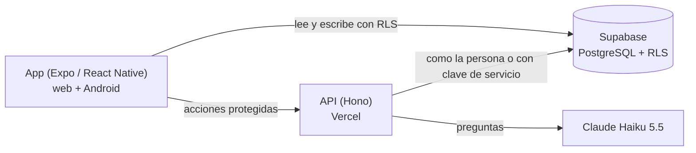
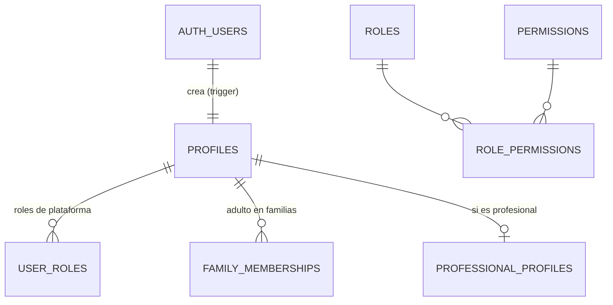
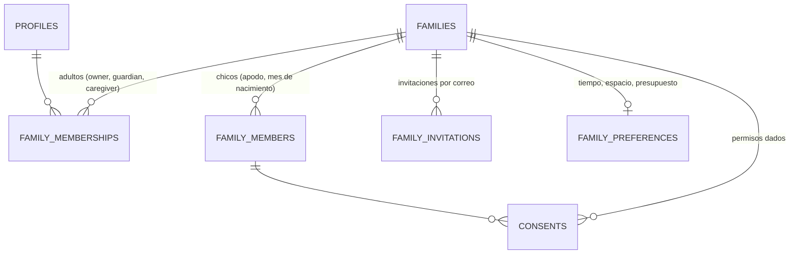
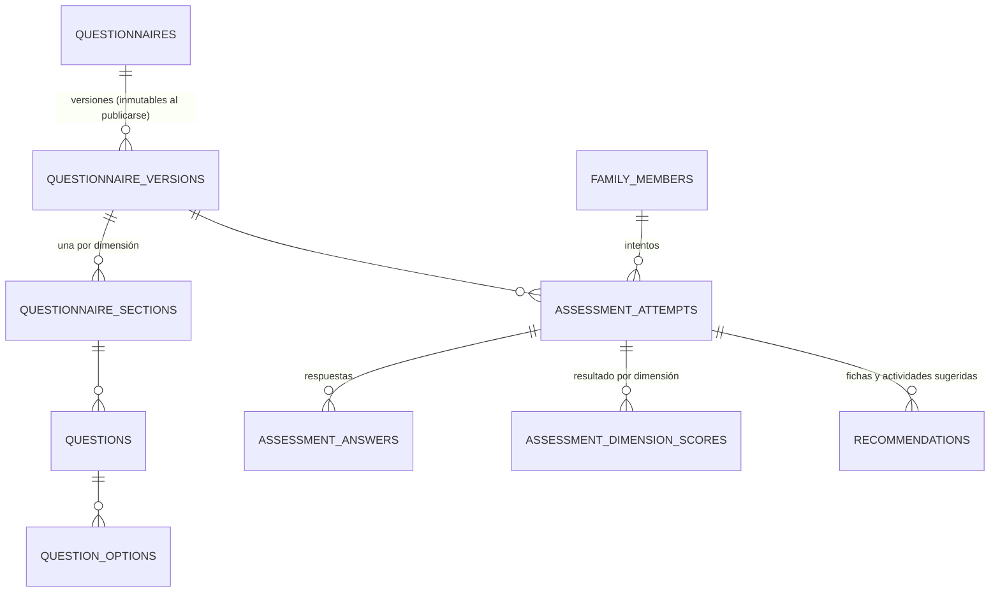
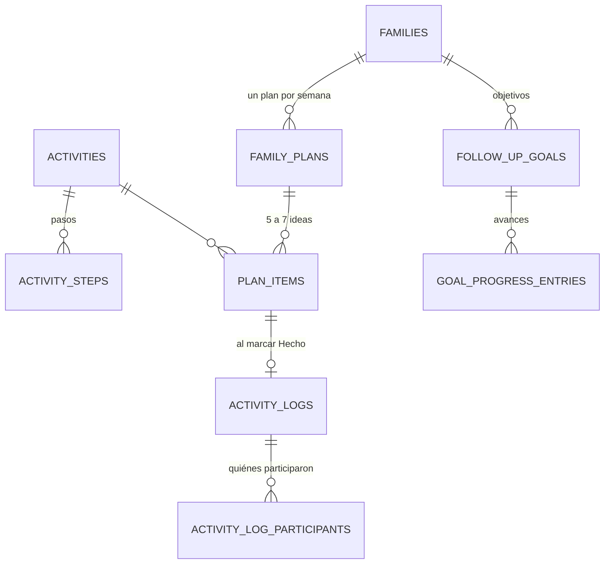
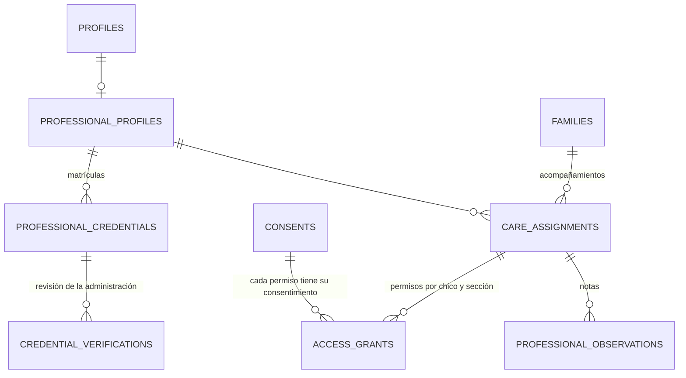
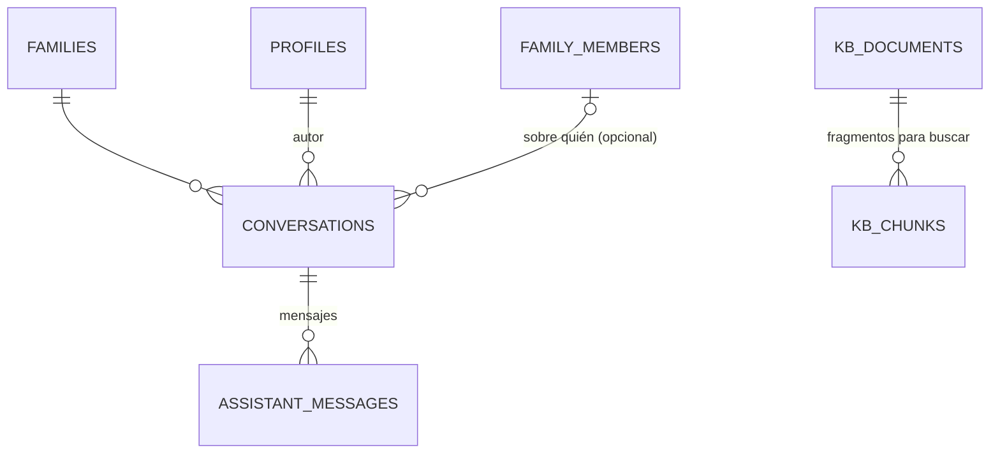

# Guía de estudio: cómo funciona Crecer en Casa

Para entender (y defender) el proyecto completo: qué datos hay, cómo se relacionan, qué pasa en
cada acción importante y dónde está cada cosa en el código. Para el detalle técnico de cada parte,
seguí los enlaces a los documentos de `docs/planning/`.

> **Cómo estudiar con esta guía:** leé una sección, hacé el ejercicio con la demo
> (`crecer-demo.vercel.app`) y mirá en Supabase (**Table Editor**) qué filas aparecieron. Al final
> hay 40 preguntas de práctica para decir en voz alta.

## Índice

1. [La idea en un minuto](#1-la-idea-en-un-minuto)
2. [Las cuatro piezas](#2-las-cuatro-piezas)
3. [Personas y cuentas](#3-personas-y-cuentas)
4. [Familias y chicos](#4-familias-y-chicos)
5. [Chequeos y evaluaciones](#5-chequeos-y-evaluaciones)
6. [Plan, actividades, rachas y objetivos](#6-plan-actividades-rachas-y-objetivos)
7. [Profesionales](#7-profesionales)
8. [El asistente y los chats](#8-el-asistente-y-los-chats)
9. [Biblioteca y contenidos](#9-biblioteca-y-contenidos)
10. [Administración](#10-administración)
11. [Seguridad: quién puede ver qué](#11-seguridad-quién-puede-ver-qué)
12. [¿Dónde está…?](#12-dónde-está)
13. [Ejercicios con la demo](#13-ejercicios-con-la-demo)
14. [Preguntas de práctica](#14-preguntas-de-práctica)

---

## 1. La idea en un minuto

Crecer en Casa acompaña a familias que crían con pantallas. Tiene cuatro funciones:

| Función         | Qué hace                                                           | Dónde se ve                 |
| --------------- | ------------------------------------------------------------------ | --------------------------- |
| **Comprender**  | Biblioteca pública por edad, con la evidencia etiquetada           | Inicio, etapas, fichas      |
| **Identificar** | Chequeo de 1 minuto, chequeos por tema y evaluación completa       | Hoy → chequeo, Evaluaciones |
| **Actuar**      | Plan semanal de actividades, "Hecho", rachas, logros y objetivos   | Hoy, Plan, Objetivos        |
| **Acompañarse** | Asistente que cita fuentes y profesionales verificados con permiso | Asistente, Profesionales    |

Lo que **no** es: no diagnostica, no vigila a los chicos y no reemplaza a un profesional.

## 2. Las cuatro piezas

| Pieza             | Carpeta           | Qué hace                                                                                         |
| ----------------- | ----------------- | ------------------------------------------------------------------------------------------------ |
| **App**           | `apps/app`        | Todas las pantallas. Lee y escribe directo en la base; **la base decide** qué puede ver cada uno |
| **API**           | `apps/api`        | Lo que no puede quedar en el cliente: puntajes, plan semanal, asistente, invitaciones, admin     |
| **Base de datos** | `supabase/`       | Tablas, reglas de seguridad por filas (RLS), funciones y pruebas (pgTAP)                         |
| **Lógica pura**   | `packages/domain` | Motor de puntajes, generador del plan, detección de riesgo. Sin base ni red: fácil de probar     |
| **Contratos**     | `packages/shared` | Esquemas (zod) y tipos compartidos entre app y API                                               |
| **Contenido**     | `content/`        | Fichas, actividades, fuentes y cuestionarios en texto; `pnpm content:sync` los carga a la base   |

**Idea clave para defender:** la app es "tonta" en seguridad a propósito. Aunque alguien la
modifique, la base de datos rechaza cualquier fila que no le corresponda (sección 11).

## 3. Personas y cuentas

- **`auth.users`** (de Supabase Auth): correo, contraseña cifrada, cuentas de Google/GitHub/Discord
  y verificación en dos pasos. Nosotros no guardamos contraseñas.
- **`profiles`**: una fila por persona, con el mismo `id`. La crea sola la función
  `handle_new_user()` cuando alguien se registra (toma el nombre de Google o la parte del correo).
- Hay **dos tipos de rol** distintos, y conviene no mezclarlos:
  - **En una familia** (`family_memberships.role`): `owner` (responsable principal), `guardian`
    (responsable) y `caregiver` (cuidador/a, ve el plan y marca actividades, pero no ve evaluaciones
    ni usa el asistente).
  - **En la plataforma** (`user_roles`): `platform_admin`, `content_editor`, `content_publisher`,
    `credential_verifier` y `auditor`. Cada rol tiene permisos (`role_permissions`). Se usan con
    verificación en dos pasos.
- **Profesional**: no es otro tipo de cuenta. Es la misma persona con una fila en
  `professional_profiles` (sección 7).

**Código:** registro en `apps/app/src/app/(auth)/registrarse.tsx`; sesión en
`apps/app/src/features/auth/`; trigger en `supabase/migrations/20261027000200_identity_access.sql`.

## 4. Familias y chicos

- **`families`**: el espacio compartido ("Mi familia"). También guarda si la familia quiere
  conservar el historial del chat (`chat_history_enabled`, `chat_retention_days`).
- **`family_memberships`**: une **adultos** con familias, con su rol y su relación (madre, abuela…).
  Un adulto puede estar en varias familias; una familia tiene siempre al menos un `owner`.
- **`family_members`**: los **chicos**. Solo apodo, mes y año de nacimiento e intereses de una lista
  cerrada. **Nunca** nombre real, DNI, escuela ni fotos (minimización de datos).
- **`family_invitations`**: para sumar a otro adulto. Se guarda el **hash** del token, no el token.
- **`consents`**: cada permiso que da la familia, con su versión de política y si se revocó.
  Propósitos: `terms_privacy`, `chat_history`, `child_data`, `ai_personal_context` y
  `professional_access`. Si se revoca `child_data`, el integrante se archiva solo.

**Alta en un paso (rediseño):** la bienvenida llama a `useQuickStart()`
(`apps/app/src/features/families/queries.ts`), que acepta los términos y llama a dos funciones de la
base: `create_family` (crea la familia y la membresía `owner`) y `add_family_member` (crea al chico
con su consentimiento `child_data`). Son funciones **atómicas**: o se crea todo o nada.

## 5. Chequeos y evaluaciones

- Hay tres cuestionarios: `habitos` (evaluación completa), `chequeo` (1 minuto, 6 preguntas) y
  `tema-*` (sueño, calma, pantallas, movimiento, acuerdos). Se escriben en
  `content/questionnaires/*.yaml` y se publican con `pnpm content:sync`.
- Una versión publicada **no se puede cambiar** (`protect_questionnaire_version`): si cambia el
  texto, se publica la versión 2. Así un resultado viejo siempre se puede explicar.
- **Recorrido de un chequeo:**
  1. La app llama a `start_assessment` (crea un `assessment_attempt` "en curso").
  2. Cada respuesta se guarda con `save_answer`.
  3. Al terminar, la app llama a la API: `POST /v1/assessments/:id/submit`.
  4. La API corre el **motor de puntajes** (`packages/domain/src/scoring/engine.ts`,
     `scoreAttempt` y `recommend`): reglas fijas, sin IA.
  5. `finalize_assessment` guarda los puntajes y las recomendaciones.
- **Bandas:** `strength` (fortaleza), `watch` (para mirar) y `priority` (por dónde empezar).
- Los chequeos por tema copian las respuestas del chequeo de 1 minuto (`useQuickAnswers`) para no
  repetir preguntas.

**Para defender:** el puntaje es **explicable**. Cada resultado muestra qué respuestas pesaron, y la
IA nunca puntúa.

## 6. Plan, actividades, rachas y objetivos

- **Plan semanal:** la app llama a `POST /v1/plans/generate`. La API junta edades, preferencias,
  recomendaciones y lo hecho en los últimos días, y el **generador**
  (`packages/domain/src/plans/generator.ts`) elige de 5 a 7 actividades. Siempre incluye una de 10
  minutos sin materiales. Se guarda con `save_week_plan`.
- **"Hecho":** `complete_plan_item` crea un `activity_log` con su fecha (`done_on`) y los
  participantes.
- **Rachas y logros** (rediseño) **no tienen tablas propias**: se calculan con `activity_logs` y
  los chequeos enviados (`apps/app/src/features/logros/logros.ts`).
- **Objetivos:** `follow_up_goals` (por familia o por chico) con sus avances. Un profesional puede
  proponer objetivos si la familia le dio el permiso.

## 7. Profesionales

1. **Perfil y credenciales:** el profesional crea su perfil y carga su matrícula (con un archivo
   privado). Un `credential_verifier` la revisa (`POST /v1/admin/credentials/:id/verify`). Recién
   ahí aparece en el **directorio**.
2. **Pedido:** la familia elige un profesional y llama a `request_care`. Indica **qué chico** y
   **qué secciones** comparte. Cada permiso es una fila de `access_grants` con un `scope`:
   `member_profile`, `assessments`, `goals`, `activities`, `observations` (por chico), y
   `family_goals`, `family_plans` (de la familia).
3. **Aceptación:** el profesional acepta con `respond_care_request`. Los permisos se activan.
4. **Lectura:** cada consulta del profesional pasa por `pro_has_scope(familia, chico, sección)`. Si
   no hay permiso activo, la base no devuelve nada. Cada vez que abre un resumen queda registrado y
   la familia lo ve.
5. **Revocar:** la familia revoca un permiso (`revoke_access_grant`) o termina el acompañamiento
   (`end_care`), y todo se corta en el momento.

**Ejemplo de la demo:** la Lic. Ríos ve a **Sofi**, pero no a **Tomi**: así lo eligió la familia
García.

## 8. El asistente y los chats

**Dónde se guardan los chats:**

- **`conversations`**: una por charla. Guarda la familia, **quién la escribió** (`user_id`), sobre
  qué chico (opcional), si usa el contexto de la familia (`use_personal_context`) y **cuándo
  vence** (`expires_at`).
- **`assistant_messages`**: cada mensaje (de la persona o del asistente), con las citas, el nivel de
  riesgo, el resultado y el modelo usado. **Solo los escribe la API**: el cliente no puede
  inventar ni editar el historial.
- **Quién puede leer un chat:** solo **su autor**, si es `owner` o `guardian` de esa familia y si
  no venció (regla `conversations_own`). Ni el otro adulto de la familia, ni la cuidadora, ni los
  profesionales, ni la administración.
- **Vencimiento:** por defecto, **24 horas**. Si la persona dio el consentimiento `chat_history`
  y la familia activó el historial, se guarda los días que eligió la familia (30 por defecto).
  `purge_expired_assistant_data` borra lo vencido.

**Qué pasa cuando alguien pregunta** (`apps/api/src/modules/assistant/route.ts`):

1. **Cuotas:** límite por minuto, por día y un tope de gasto mensual (`assistant_quota`).
2. **Riesgo:** `packages/domain/src/safety/risk.ts` busca frases de riesgo (autolesión, violencia,
   urgencia médica). Si aparece una, responde con las **líneas de ayuda fijas**, **sin consultar al
   modelo**.
3. **Historial:** carga los últimos 12 mensajes de esa conversación.
4. **Búsqueda (RAG):** busca en la biblioteca del proyecto (`kb_hybrid_search` sobre
   `kb_chunks`), por texto y, si hay clave de Voyage, también por significado.
5. **Sin respaldo, no inventa:** si no encuentra suficientes fragmentos, responde que no tiene
   información, sin llamar al modelo.
6. **Contexto de la familia** (solo con el consentimiento `ai_personal_context`): edad del chico
   (**sin el apodo**), último resultado por dimensión, recomendaciones, actividades hechas,
   preferencias y objetivos. Es un bloque corto, de unos 400 tokens.
7. **Modelo:** Claude Haiku 5.5 (`apps/api/src/ai/providers/anthropic.ts`), por streaming. Si en
   el texto aparece algo prohibido, se corta (`postcheck.ts`).
8. **Guardado:** guarda la respuesta con sus citas y suma el costo a `ai_usage_daily`.

**El contexto del modelo es:** instrucciones fijas (`apps/api/src/ai/prompts`) + fragmentos de la
biblioteca + últimos mensajes + (opcional) el bloque de la familia. **Nunca** recibe nombres, correos
ni datos de otras familias.

## 9. Biblioteca y contenidos

- **`sources`**: las 22 fuentes (OMS, SAP, AAP, estudios), con su tipo y verificación.
- **`content_items`**: etapas por edad y fichas, con su **etiqueta de evidencia** (recomendación
  oficial, asociación que no prueba causa, propuesta del proyecto). Historial en
  `content_revisions`.
- **`activities`**: 30 actividades con pasos, edades, duración, costo, espacio y fuentes.
- **`kb_documents` y `kb_chunks`**: la misma biblioteca cortada en fragmentos para el asistente
  (`pnpm kb:ingest`).
- Todo se escribe en `content/` (Markdown y YAML) y `pnpm content:check` lo valida antes de cargarlo.

## 10. Administración

- Pantallas en `apps/app/src/app/admin/`, funciones `admin_*` en
  `supabase/migrations/20261028000400_admin.sql`.
- Cada acción pide un **permiso** (`has_admin_permission`) y verificación en dos pasos.
- **`audit_log`**: quién hizo qué y cuándo, **sin** el texto de mensajes u observaciones. Nadie
  puede modificarlo (`prevent_audit_log_changes`).
- **`app_settings`**: configuración (por ejemplo, el tope de gasto de la IA).
- La administración **no** puede leer evaluaciones, chats ni datos de las familias.

## 11. Seguridad: quién puede ver qué

**RLS (Row Level Security):** cada tabla tiene reglas que PostgreSQL evalúa en **cada** consulta,
con la identidad de quien pregunta (`auth.uid()`). Si la regla no se cumple, la fila no existe para
esa persona.

| Función de ayuda            | Pregunta que responde                                          |
| --------------------------- | -------------------------------------------------------------- |
| `is_family_adult(f, roles)` | ¿Soy adulto de esta familia (con alguno de estos roles)?       |
| `shares_family_with(u)`     | ¿Comparto alguna familia con esta persona?                     |
| `pro_has_scope(f, m, s)`    | ¿Soy profesional con permiso activo para este chico y sección? |
| `has_permission(p)`         | ¿Tengo este permiso de plataforma?                             |

| Quién                | Ve                                                           | No ve                                   |
| -------------------- | ------------------------------------------------------------ | --------------------------------------- |
| `owner` / `guardian` | Todo lo de su familia; sus propios chats                     | Chats de otro adulto; otras familias    |
| `caregiver`          | Plan, actividades, objetivos                                 | Evaluaciones, asistente                 |
| Profesional          | Solo los chicos y secciones con permiso activo               | Chats, lo no compartido, otras familias |
| Administración       | Usuarios, roles, contenidos, credenciales, auditoría, costos | Datos de familias, evaluaciones, chats  |
| Sin cuenta           | Biblioteca, actividades y directorio públicos                | Todo lo demás                           |

Además: las operaciones delicadas son **funciones `security definer`** que validan todo adentro
(`create_family`, `request_care`, `save_week_plan`…), y hay **231 pruebas pgTAP**
(`supabase/tests/`) que comprueban estas reglas en cada cambio. Ver también
[DEFENSA_BASE_DE_DATOS.md](DEFENSA_BASE_DE_DATOS.md) y
[ROLES_AND_PERMISSIONS.md](planning/ROLES_AND_PERMISSIONS.md).

## 12. ¿Dónde está…?

| Busco…                                | Está en                                                                |
| ------------------------------------- | ---------------------------------------------------------------------- |
| Una pantalla                          | `apps/app/src/app/` (cada archivo es una ruta: `hoy.tsx` → `/hoy`)     |
| Lo que lee o escribe una pantalla     | `apps/app/src/features/<tema>/queries.ts`                              |
| Componentes visuales (botones, etc.)  | `apps/app/src/ui/`                                                     |
| Colores y tipografías                 | `apps/app/src/ui/tokens.ts`                                            |
| Brote                                 | `apps/app/src/features/brote/Brote.tsx`                                |
| Sonidos y vibraciones                 | `apps/app/src/features/feedback/feedback.ts`                           |
| Rutas de la API                       | `apps/api/src/modules/<tema>/route.ts` (documentadas en `docs/API.md`) |
| Cómo se llama a Claude                | `apps/api/src/ai/providers/anthropic.ts` y `apps/api/src/ai/prompts/`  |
| Puntajes                              | `packages/domain/src/scoring/engine.ts`                                |
| Generador del plan                    | `packages/domain/src/plans/generator.ts`                               |
| Detección de riesgo                   | `packages/domain/src/safety/`                                          |
| Tablas y reglas de seguridad          | `supabase/migrations/` (en orden: identidad, familias, contenido…)     |
| Pruebas de seguridad de la base       | `supabase/tests/`                                                      |
| Textos de la biblioteca y actividades | `content/`                                                             |
| Decisiones y su porqué                | `docs/planning/DECISIONS.md` (ADR-001 a ADR-035)                       |

Cada carpeta importante tiene su `README.md` con qué hay ahí y por dónde empezar.

## 13. Ejercicios con la demo

Abrí la demo con una cuenta (las contraseñas están en tu archivo de cuentas) y, en otra pestaña,
Supabase → proyecto demo → **Table Editor**.

1. **Entrá como Laura** y abrí Hoy. Buscá en `family_memberships` su fila: ¿qué rol tiene?
2. **Marcá "Hecho"** en la actividad de hoy. Buscá la fila nueva en `activity_logs` y en
   `activity_log_participants`. ¿Qué `plan_item` cambió de estado?
3. **Hacé un chequeo por tema.** Mirá `assessment_attempts` (estado `submitted`),
   `assessment_dimension_scores` y `recommendations`.
4. **Preguntale algo al asistente.** Buscá la conversación en `conversations`: ¿cuándo vence? Y sus
   mensajes en `assistant_messages`: ¿qué guarda en `citations`?
5. **Entrá como Norma** (cuidadora): ¿ves Evaluaciones o Asistente? ¿Por qué? (sección 11).
6. **Entrá como Paula** (profesional): abrí a Sofi y probá con Tomi. Buscá en `access_grants` qué
   permisos tiene y en `audit_log` el acceso que acabás de hacer.
7. **Buscá en `profiles`** a todas las personas registradas. ¿Por qué no hay contraseñas ahí?

## 14. Preguntas de práctica

Respondé en voz alta y después compará.

**Datos y relaciones**

1. **¿Dónde están las personas registradas?** En `auth.users` (Supabase Auth: correo, contraseña
   cifrada, proveedores) y en `profiles` (nombre visible y preferencias), con el mismo id.
2. **¿Cómo se relaciona un adulto con una familia?** Con `family_memberships`, que dice el rol
   (`owner`, `guardian`, `caregiver`) y la relación. Es una relación muchos a muchos.
3. **¿Y los chicos?** Son `family_members`, que pertenecen a una sola familia. No tienen cuenta.
4. **¿Por qué los chicos no tienen nombre real?** Por minimización: con apodo y mes de nacimiento
   alcanza para orientar, y un dato que no se guarda no se puede filtrar.
5. **¿Cómo se relaciona un profesional con una familia?** Con `care_assignments` (el
   acompañamiento) y `access_grants` (qué chico y qué sección puede ver).
6. **¿Dónde se guardan los chats?** En `conversations` y `assistant_messages`.
7. **¿Quién puede leer un chat?** Solo su autor, si es `owner` o `guardian` y no venció.
8. **¿Cuánto dura un chat?** 24 horas, salvo que la persona y la familia elijan conservarlo (30
   días por defecto).
9. **¿Qué es un consentimiento en el sistema?** Una fila en `consents` con propósito, versión de
   política y fecha; si se revoca, se registra cuándo y por quién.
10. **¿Por qué un cuestionario tiene versiones?** Porque una versión publicada no se puede cambiar:
    así cada resultado se puede explicar con las preguntas que se respondieron.

**Seguridad**

11. **¿Qué pasa si alguien modifica la app para pedir datos de otra familia?** La base aplica RLS
    en cada consulta y no devuelve esas filas. La seguridad no depende de la app.
12. **¿Qué es RLS?** Reglas de PostgreSQL que deciden, fila por fila, quién puede leer o escribir,
    usando la identidad del token.
13. **¿Para qué está la API si la app habla directo con la base?** Para lo que no puede confiarse
    al cliente: puntajes, plan, asistente (con su clave), invitaciones y administración.
14. **¿Qué ve la administración?** Usuarios, roles, contenidos, credenciales, auditoría y costos.
    Nunca evaluaciones ni chats.
15. **¿Cómo se protege la cuenta de administración?** Con roles separados, verificación en dos
    pasos obligatoria y auditoría.
16. **¿Qué guarda la auditoría?** Quién, qué acción, sobre qué y cuándo; nunca el texto de
    mensajes u observaciones. Y no se puede modificar.
17. **¿Cómo se prueba que las reglas funcionan?** Con 231 pruebas pgTAP que corren en cada cambio
    en GitHub.
18. **¿Por qué PostgreSQL y no MySQL?** Por RLS nativa, funciones `security definer`, búsqueda de
    texto en español y pgvector (ver `DEFENSA_BASE_DE_DATOS.md`).
19. **¿Cómo se maneja la sesión?** Supabase Auth da un token de acceso (JWT) corto y uno de
    renovación; la app los guarda en SecureStore (celular) o localStorage (web).
20. **¿Qué es el inicio con Google?** OAuth: Google confirma quién sos y Supabase crea la sesión.
    La app nunca ve la contraseña de Google.

**Asistente**

21. **¿Qué modelo usa y por qué?** Claude Haiku 5.5: barato (menos de 0,1 centavo por respuesta),
    rápido y suficiente para responder con fragmentos dados.
22. **¿Cómo evita inventar?** Solo responde con fragmentos de la biblioteca (RAG) y los cita; si no
    encuentra respaldo, lo dice sin llamar al modelo.
23. **¿Qué pasa ante una frase de riesgo?** Se detecta antes del modelo y se muestran líneas de
    ayuda fijas.
24. **¿Qué datos de la familia recibe?** Solo con permiso: edad (sin apodo), resultados,
    recomendaciones, actividades, preferencias y objetivos. Nunca nombres ni correos.
25. **¿Cómo se controla el gasto?** Cuotas por minuto y por día, y un tope mensual que pausa el
    asistente.
26. **¿Por qué el cliente no puede escribir mensajes del asistente?** Para que nadie pueda
    falsificar el historial: solo la API los guarda.

**Funcionalidades**

27. **¿Cómo se calcula el resultado de un chequeo?** Con reglas fijas del motor de puntajes
    (`scoreAttempt`): cada respuesta suma a una dimensión y se compara con cortes.
28. **¿La IA interviene en el puntaje?** No.
29. **¿Cómo se arma el plan semanal?** El generador filtra actividades por edad, tiempo, espacio y
    presupuesto, prioriza lo recomendado y agrega variedad y una opción de 10 minutos.
30. **¿Dónde se guardan las rachas y logros?** En ningún lado: se calculan con `activity_logs` y los
    chequeos enviados.
31. **¿Qué puede hacer la cuidadora?** Ver el plan, marcar actividades y ver objetivos.
32. **¿Cómo se suma otro adulto?** Con una invitación por correo; el token se guarda hasheado.
33. **¿Cómo se verifica un profesional?** Carga su matrícula y un verificador la revisa; recién
    verificado aparece en el directorio.
34. **¿Puede un profesional ver a todos los chicos de una familia?** No: solo los que la familia
    eligió, en las secciones elegidas, y se puede revocar.
35. **¿Cómo se publica un contenido nuevo?** Se escribe en `content/`, se valida con
    `pnpm content:check` y se carga con `pnpm content:sync`.

**Proyecto y decisiones**

36. **¿Por qué una sola app para web y Android?** Expo y React Native comparten el código.
37. **¿Cómo se publica?** Vercel publica web y API con cada cambio en `main`; la APK se compila con
    EAS.
38. **¿Qué cambiaron después de la prueba con el profesor?** Entrada mínima, chequeo de 1 minuto,
    Brote, Hoy con una idea para hoy, Pausa para vos y validación campo por campo (ADR-035).
39. **¿Cómo se prueba el sistema?** Pruebas de dominio, API, app y base (más de 1.000) en cada
    cambio, más el control de formato y tipos.
40. **¿Qué falta para usarlo con familias reales?** Revisión profesional del contenido, dictamen
    legal sobre los datos de los chicos y un piloto con consentimiento.
