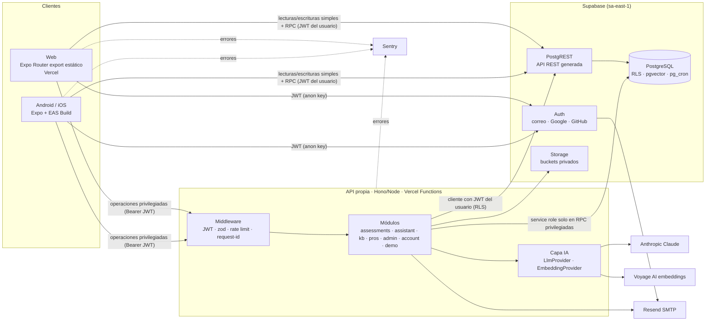
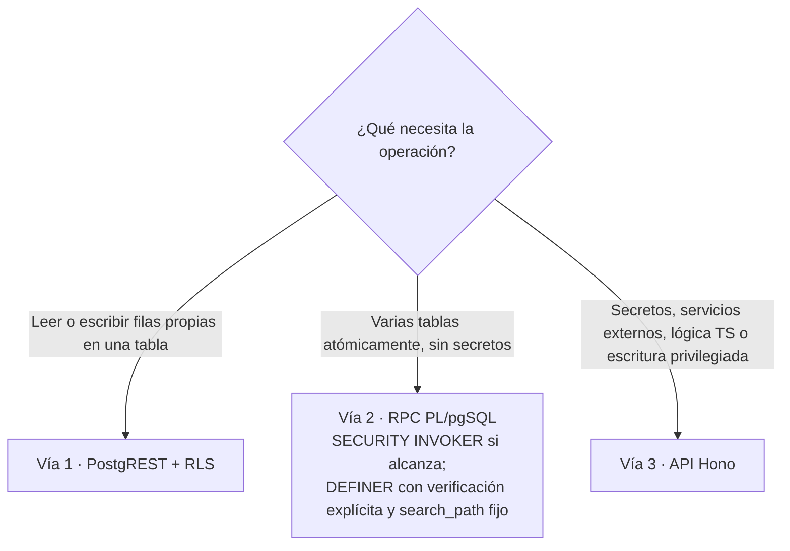
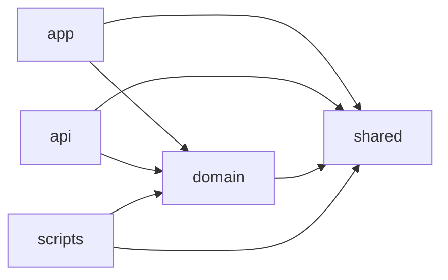
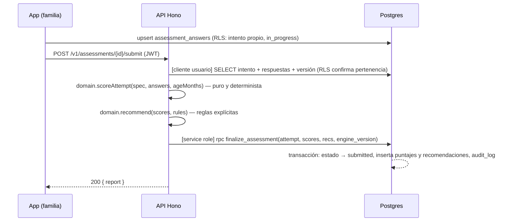
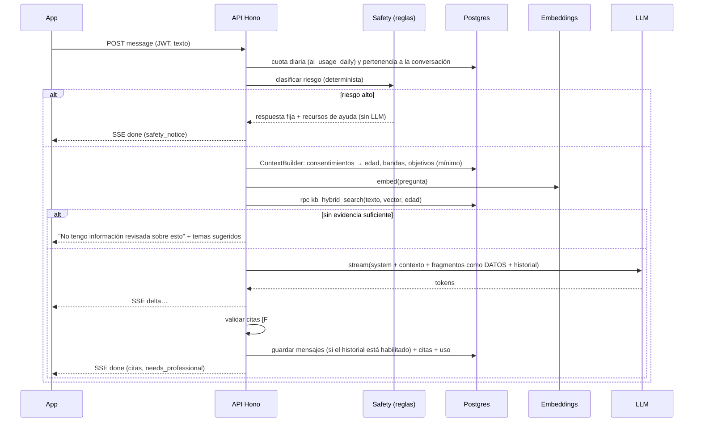
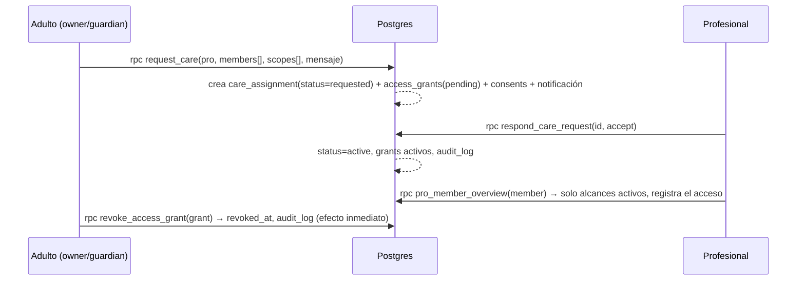

# Arquitectura

## 1. Vista de componentes



## 2. Responsabilidades por componente

| Componente           | Responsable de                                                                                                                              | NO es responsable de                                                                     |
| -------------------- | ------------------------------------------------------------------------------------------------------------------------------------------- | ---------------------------------------------------------------------------------------- |
| **App (Expo)**       | UI, navegación, validación de formularios (UX), caché, estados de carga, error y vacío, accesibilidad                                       | Autorizar nada. Ocultar un botón es solo comodidad: la seguridad está en RLS y en la API |
| **Supabase Auth**    | Identidad, sesiones, OAuth, verificación de correo, MFA                                                                                     | Roles de negocio (viven en tablas propias)                                               |
| **PostgreSQL + RLS** | Integridad (FK, CHECK, UNIQUE), **autorización final de cada fila**, transacciones atómicas (RPC), auditoría con triggers, búsqueda híbrida | Llamar a servicios externos                                                              |
| **API Hono**         | Secretos, IA, puntuación, ingestión, correos, procesos de cuenta, verificación y demo; validación zod del lado del servidor; límites de uso | Reemplazar a RLS: siempre usa el JWT del usuario salvo en las RPC privilegiadas listadas |
| **Storage**          | Archivos de credenciales y documentos fuente                                                                                                | Archivos públicos (no hay en P0)                                                         |

## 3. La regla de las tres vías



Ejemplos concretos:

| Operación                                                       | Vía                                                        | Motivo                                                               |
| --------------------------------------------------------------- | ---------------------------------------------------------- | -------------------------------------------------------------------- |
| Editar el perfil o guardar un favorito                          | 1                                                          | Una fila propia                                                      |
| Listar actividades o leer la biblioteca                         | 1                                                          | Lectura pública (`published`)                                        |
| Crear una familia (familia + membresía de dueño + preferencias) | 2 `create_family()`                                        | Atómica                                                              |
| Invitar a un adulto                                             | 3 `POST /v1/families/:id/invitations`                      | Genera un token y envía un correo                                    |
| Aceptar una invitación                                          | 2 `accept_family_invitation(token)`                        | Atómica y valida el hash del token                                   |
| Responder un cuestionario (borrador)                            | 1                                                          | Filas propias de `assessment_answers`                                |
| **Enviar y puntuar** un intento                                 | 3 `POST /v1/assessments/:attemptId/submit`                 | Motor de reglas en TS + escritura privilegiada de resultados         |
| Generar un plan semanal                                         | 3 `POST /v1/plans/generate`                                | Lógica en TS (`packages/domain`)                                     |
| Marcar una actividad del plan como hecha                        | 1                                                          | Una fila                                                             |
| Mensaje al asistente                                            | 3 `POST /v1/assistant/conversations/:id/messages` (stream) | LLM, embeddings, cuotas                                              |
| Pedir acompañamiento a un profesional                           | 2 `request_care(...)`                                      | Asignación + permisos pendientes + notificación en una transacción   |
| El profesional acepta o rechaza                                 | 2 `respond_care_request(...)`                              | Atómica + auditoría                                                  |
| El profesional consulta el resumen de un integrante             | 2 `pro_member_overview(member_id)` (DEFINER)               | Filtra por alcance y **registra el acceso**                          |
| Registrar una observación                                       | 1                                                          | Una fila; RLS exige una asignación activa con alcance `observations` |
| Subir una credencial                                            | 1 (Storage) + 1 (fila)                                     | Políticas de Storage por carpeta `{user_id}/`                        |
| Aprobar una credencial                                          | 3 `POST /v1/admin/credentials/:id/verify`                  | Permiso + transacción + auditoría + notificación                     |
| Ingerir un documento de la base de conocimiento                 | 3 `POST /v1/admin/kb/documents/:id/ingest`                 | Extracción, fragmentación y embeddings                               |
| Exportar o borrar la cuenta                                     | 3 `/v1/account/export`, `/v1/account` DELETE               | Recorre muchas tablas y usa la API de administración de Auth         |
| Reiniciar la demo                                               | Script CLI `pnpm demo:reset` (no hay endpoint público)     | Solo para el operador y solo en el entorno `demo`                    |

## 4. Estructura del monorepo

```
Proyecto-Final/
├─ apps/
│  ├─ app/                         # Expo: iOS, Android y Web
│  │  ├─ src/
│  │  │  ├─ app/                   # rutas de Expo Router (convención de Expo SDK 58; ver UX_AND_NAVIGATION.md)
│  │  │  │  ├─ (public)/           # biblioteca, actividades públicas, ingreso
│  │  │  │  ├─ (auth)/             # login, registro, recuperación, callback OAuth
│  │  │  │  ├─ (family)/           # espacio familiar (protegido)
│  │  │  │  ├─ (pro)/              # espacio profesional (protegido)
│  │  │  │  └─ (admin)/            # administración (protegido + permisos)
│  │  │  ├─ ui/                    # sistema de diseño: tokens, Button, Field, Card, Chip…
│  │  │  ├─ features/              # un directorio por módulo: hooks, componentes, pantallas
│  │  │  │  ├─ auth/ families/ assessments/ activities/ plans/
│  │  │  │  ├─ assistant/ professionals/ admin/ library/
│  │  │  ├─ lib/                   # supabase client, api client, query client, sentry
│  │  │  └─ copy/                  # textos de interfaz por módulo (preparado para i18n)
│  │  ├─ app.config.ts  eas.json  tailwind.config.js
│  ├─ api/                         # Hono + Node
│  │  ├─ src/
│  │  │  ├─ app.ts                 # composición de rutas y middleware
│  │  │  ├─ middleware/            # auth, requestId, errors, rateLimit, cors
│  │  │  ├─ lib/                   # supabase (user/service), logger, env (zod)
│  │  │  ├─ modules/
│  │  │  │  ├─ assessments/  plans/  assistant/  kb/
│  │  │  │  ├─ professionals/  admin/  account/  families/
│  │  │  └─ ai/                    # providers/, prompts/, retrieval/, safety/
│  │  ├─ scripts/                  # ingest-content.ts, eval-assistant.ts
│  │  └─ api/index.ts              # entrada para Vercel
├─ packages/
│  ├─ shared/                      # esquemas zod, tipos de dominio, catálogo de permisos,
│  │                               # enums, códigos de error, tipos generados de la BD
│  ├─ domain/                      # lógica pura y testeable: puntuación, recomendaciones,
│  │                               # generador de planes, edad en meses, reglas de riesgo
│  └─ config/                      # tsconfig base, eslint, prettier
├─ supabase/
│  ├─ config.toml
│  ├─ migrations/                  # SQL versionado (ver DATABASE.md)
│  ├─ seed.sql                     # catálogos base (roles, permisos, categorías)
│  └─ tests/                       # pgTAP: RLS y funciones
├─ content/                        # contenido canónico inicial en Markdown + YAML
│  ├─ sources.yaml                 # bibliografía (§27)
│  ├─ library/  situations/  activities/  questionnaires/
├─ scripts/
│  ├─ demo/                        # seed-demo.ts, reset-demo.ts, fixtures/
│  └─ backup/                      # pg_dump cifrado
├─ docs/
│  ├─ planning/                    # este directorio
│  ├─ research/                    # copia versionada de la investigación (Fase 1)
│  └─ api/                         # OpenAPI generado
├─ .github/workflows/
├─ turbo.json  pnpm-workspace.yaml  package.json  .env.example
```

**Criterio de cohesión:** cada módulo de `features/` (app) y de `modules/` (API) agrupa lo que cambia junto, es decir, rutas, esquemas, consultas y pruebas. **No** se crean paquetes por cada capa técnica: hay solo 3 paquetes compartidos y cada uno tiene un consumidor claro.

### 4.1 Dependencias permitidas



- `shared` y `domain` **no** dependen de React, de Hono ni de Supabase: son TypeScript puro.
- La regla se controla con ESLint (`import/no-restricted-paths`).

## 5. Comunicación y contratos

- **Contratos:** cada endpoint de la API tiene un esquema zod de entrada y uno de salida en `packages/shared/src/api/`. La app los usa para tipar las respuestas, y la API, para validarlas (con `@hono/zod-validator`). La documentación OpenAPI se genera con `@hono/zod-openapi` y se publica en `docs/api/`.
- **Versionado de la API:** prefijo `/v1`. Los cambios incompatibles van a `/v2`.
- **Formato de error único** (RFC 9457 simplificado):

```json
{
  "error": {
    "code": "ASSESSMENT_ALREADY_SUBMITTED",
    "message": "Esta evaluación ya fue enviada.",
    "requestId": "c0f…"
  }
}
```

Los códigos de error son un enum en `shared`, y la app los traduce a mensajes amigables. No se exponen trazas ni mensajes de SQL.

- **Streaming del asistente:** Server-Sent Events sobre `fetch` con eventos `meta` (fuentes recuperadas), `delta` (texto), `done` (citas validadas e indicadores) y `error`.
- **Idempotencia:** los POST que crean recursos aceptan el encabezado `Idempotency-Key` (guardado 24 h) para evitar duplicados por reintentos en redes móviles. Es P1, salvo en `submit` de evaluaciones, que es idempotente por estado.

### 5.1 Endpoints de la API (v1)

| Módulo        | Método y ruta                                                                                                                                                                                                                                                                             | Prioridad |
| ------------- | ----------------------------------------------------------------------------------------------------------------------------------------------------------------------------------------------------------------------------------------------------------------------------------------- | --------- |
| health        | `GET /v1/health`                                                                                                                                                                                                                                                                          | P0        |
| families      | `POST /v1/families/:id/invitations` · `DELETE /v1/families/:id`                                                                                                                                                                                                                           | P0        |
| assessments   | `POST /v1/assessments/:attemptId/submit` · `GET /v1/assessments/:attemptId/report`                                                                                                                                                                                                        | P0        |
| plans         | `POST /v1/plans/generate`                                                                                                                                                                                                                                                                 | P0        |
| assistant     | `POST /v1/assistant/conversations` · `POST /v1/assistant/conversations/:id/messages` (SSE) · `DELETE /v1/assistant/conversations/:id` · `POST /v1/assistant/messages/:id/feedback` (P1)                                                                                                   | P0        |
| professionals | `POST /v1/professionals/credentials/:id/submit`                                                                                                                                                                                                                                           | P0        |
| admin         | `POST /v1/admin/credentials/:id/verify` · `POST /v1/admin/users/:id/roles` · `DELETE /v1/admin/users/:id/roles/:role` · `POST /v1/admin/kb/documents/:id/ingest` · `POST /v1/admin/kb/documents/:id/publish` · `POST /v1/admin/questionnaires/:versionId/publish` · `GET /v1/admin/usage` | P0        |
| account       | `GET /v1/account/export` (P1) · `DELETE /v1/account` (P0)                                                                                                                                                                                                                                 | —         |
| notifications | Lectura por la vía 1; el envío lo hacen triggers y la API                                                                                                                                                                                                                                 | P1        |

## 6. Flujos principales (secuencias)

### 6.1 Enviar una evaluación



### 6.2 Mensaje al asistente



### 6.3 Solicitud y asignación profesional



## 7. Manejo de errores y resiliencia

| Situación                                             | Comportamiento                                                                                                                             |
| ----------------------------------------------------- | ------------------------------------------------------------------------------------------------------------------------------------------ |
| Validación de entrada                                 | 400 con `VALIDATION_ERROR` y los campos con error (los mensajes vienen del esquema zod compartido)                                         |
| Sin sesión o sesión vencida                           | 401; la app intenta renovar la sesión una vez y, si falla, vuelve al login conservando la ruta                                             |
| Sin permiso                                           | 403 `FORBIDDEN` (o 404 si revelar que el recurso existe filtra información)                                                                |
| Conflicto de estado                                   | 409 (por ejemplo, una evaluación ya enviada o una asignación ya respondida)                                                                |
| Cuota de IA agotada                                   | 429 `AI_QUOTA_EXCEEDED` con la hora de reinicio                                                                                            |
| LLM: tiempo agotado o error 5xx                       | Reintento con backoff exponencial (2 intentos, como hace el SDK). Si persiste, 503 `AI_UNAVAILABLE` y la app sugiere contenido relacionado |
| El LLM se niega a responder (`stop_reason = refusal`) | Mensaje seguro y derivación a contenido; con Opus 5.5 se usa el _fallback_ del servidor **[A verificar en la Fase 7]**                     |
| Proveedor de embeddings caído                         | Búsqueda **solo de texto completo** (modo degradado, registrado)                                                                           |
| Errores no previstos                                  | 500 con `requestId`; se envían a Sentry sin datos personales                                                                               |
| App sin conexión                                      | La caché de TanStack Query muestra los últimos datos y un banner de "sin conexión"; las mutaciones se deshabilitan                         |

## 8. Entornos

| Entorno   | Supabase                                                    | API y web                                   | Datos                                          | Quién   |
| --------- | ----------------------------------------------------------- | ------------------------------------------- | ---------------------------------------------- | ------- |
| `local`   | `supabase start` (si hay Docker) o el proyecto `crecer-dev` | `pnpm dev`                                  | Seed base + seed de desarrollo                 | Equipo  |
| `preview` | `crecer-dev`                                                | Vista previa de Vercel por PR               | Seed de desarrollo                             | Equipo  |
| `demo`    | `crecer-demo` (proyecto separado)                           | `demo.<dominio>` o `crecer-demo.vercel.app` | **Solo ficticios** (`pnpm demo:reset`)         | Expotec |
| `prod`    | `crecer-prod` (se crea al lanzar)                           | Dominio principal                           | Reales, **bloqueados hasta el dictamen legal** | —       |

`APP_ENV` (`local | preview | demo | prod`) se valida al iniciar con un esquema zod. El entorno `demo` muestra un banner permanente: "Entorno de demostración · datos ficticios".

## 9. Configuración por funcionalidades

La tabla `app_settings`, más variables de entorno, permite activar y desactivar funciones **sin desplegar código**:

- `assistant.enabled`, `assistant.daily_limit_per_user`, `assistant.monthly_budget_usd`.
- `features.professionals_directory_public`: el directorio visible sin cuenta.
- `features.real_family_data`: en `false` en `prod` hasta el dictamen legal; con `false`, el registro queda limitado a usuarios invitados como testers.
- `features.appointments` (P1).
