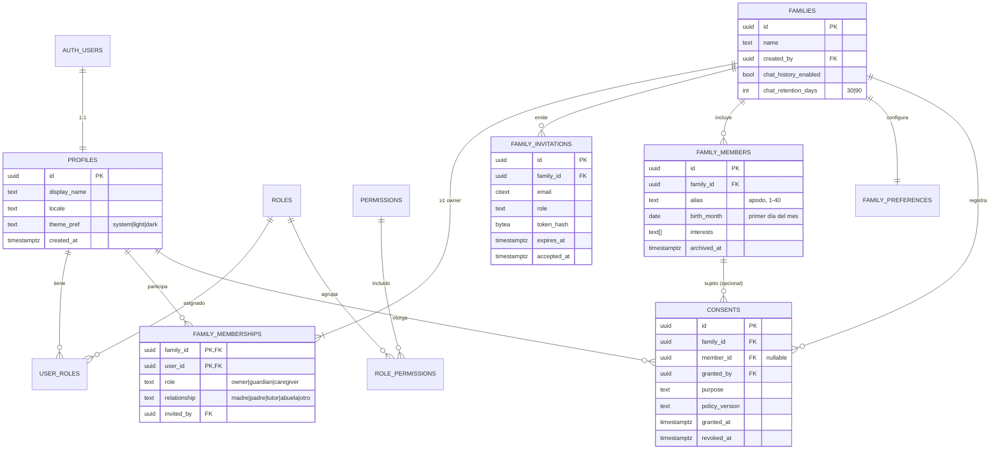
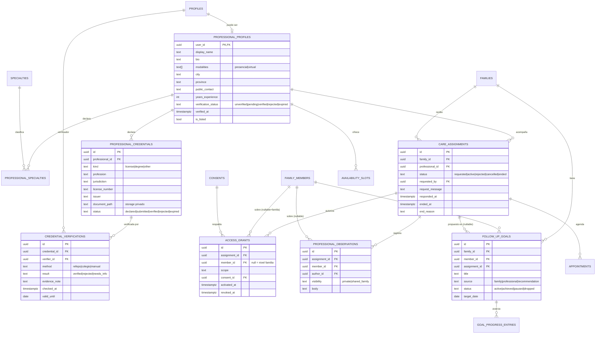
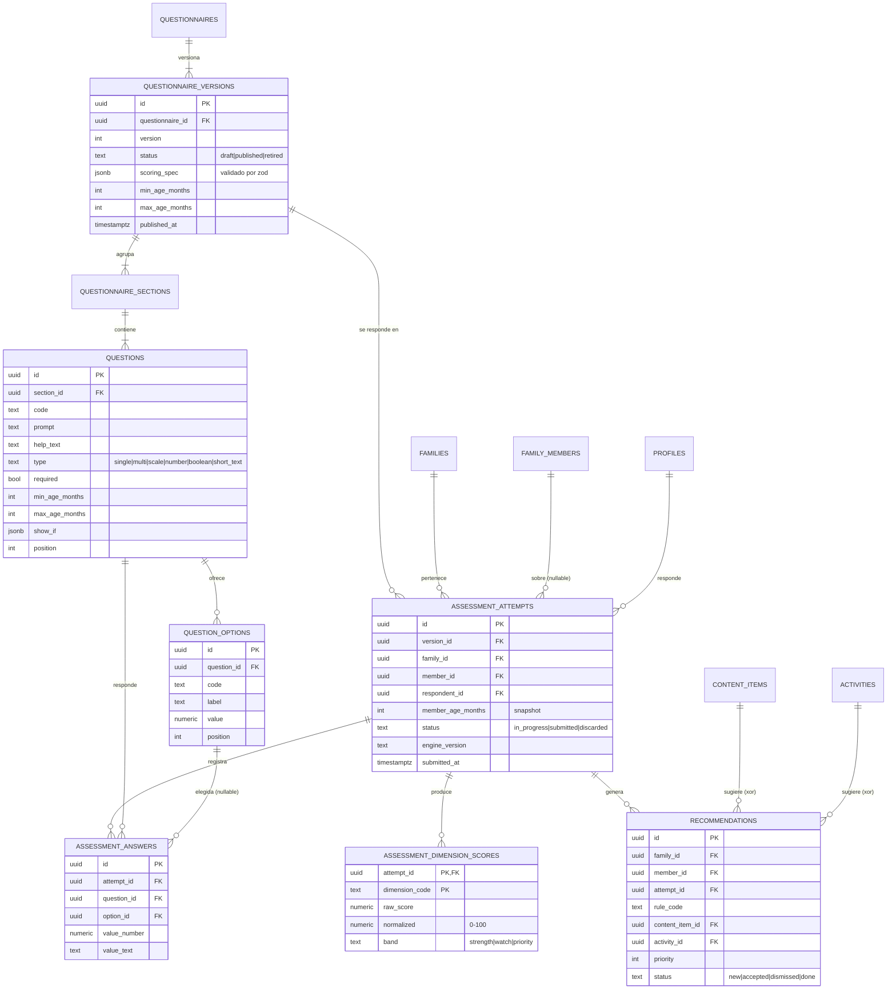
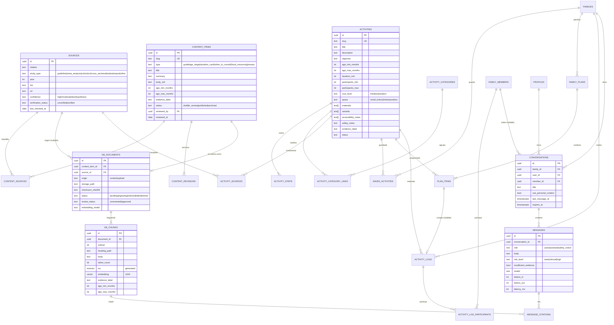

# Base de datos y modelo de dominio

> Motor: PostgreSQL (Supabase), extensiones `pgcrypto`, `citext`, `vector`, `unaccent` y `pg_cron`.
> Convenciones: tablas y columnas en `snake_case` (inglés técnico; la interfaz está en español) · PK `id uuid default gen_random_uuid()` salvo en las tablas puente · `created_at timestamptz not null default now()` · todas las FK con índice · **RLS habilitado en todas las tablas** (`alter table … enable row level security`), sin excepciones.

## 1. Decisiones de modelado

1. **La familia es la unidad de organización.** Casi todos los datos de negocio cuelgan de `families` y, cuando corresponde, de un integrante (`family_members`). La tabla `family_id` desnormalizada en tablas hijas solo aparece cuando la necesita RLS (ver §5).
2. **Los adultos con cuenta** se vinculan a la familia por `family_memberships` (muchos a muchos entre usuarios y familias). **Los integrantes menores no tienen cuenta**: son filas de `family_members`.
3. **"Ser profesional" no es un rol global:** es tener un `professional_profiles`. **"Ser familia" tampoco:** es tener al menos una membresía. Los **roles globales** (`user_roles`) son solo administrativos. Así una persona puede ser madre y psicóloga a la vez sin mezclar permisos.
4. **El acceso profesional es granular:** `care_assignments` (la relación profesional–familia y su ciclo de vida) + `access_grants` (qué integrante, qué alcance de datos y con qué consentimiento). Esto resuelve que "distintos profesionales acompañen a distintos hijos" y que "varios profesionales trabajen con el mismo integrante".
5. **Estados como `text` + `CHECK`**, no como `ENUM` de Postgres. A un ENUM no se le pueden quitar valores y complica las migraciones. Los catálogos que edita la administración (especialidades, categorías, roles, permisos) son **tablas**.
6. **Lo inmutable se versiona, no se edita.** Los cuestionarios publicados, las verificaciones de credenciales, los consentimientos (se revocan, no se borran) y la auditoría (solo se insertan filas).
7. **Datos de demostración:** van en un **proyecto de Supabase separado** (ver `EXPOTEC_DEMO.md`). No hay una columna `is_demo` mezclada con datos reales.

## 2. Inventario de entidades

Prioridad: P0 = Expotec, P1 = complementaria (la tabla se crea igual en P0 si su costo es bajo, para no migrar después).

### A. Identidad y acceso

| #   | Tabla              | Propósito                                              | Clave                            | Prioridad |
| --- | ------------------ | ------------------------------------------------------ | -------------------------------- | --------- |
| 1   | `profiles`         | Datos de la persona usuaria (1:1 con `auth.users`)     | `id` = `auth.users.id`           | P0        |
| 2   | `roles`            | Catálogo de roles **administrativos**                  | `code`                           | P0        |
| 3   | `permissions`      | Catálogo de permisos atómicos                          | `code`                           | P0        |
| 4   | `role_permissions` | Muchos a muchos entre roles y permisos                 | (`role_code`, `permission_code`) | P0        |
| 5   | `user_roles`       | Muchos a muchos entre usuarios y roles administrativos | (`user_id`, `role_code`)         | P0        |

### B. Familias

| #   | Tabla                | Propósito                                                                  | Prioridad |
| --- | -------------------- | -------------------------------------------------------------------------- | --------- |
| 6   | `families`           | Espacio familiar y sus ajustes de privacidad                               | P0        |
| 7   | `family_memberships` | Adulto ↔ familia, con rol `owner`, `guardian` o `caregiver`                | P0        |
| 8   | `family_invitations` | Invitaciones por correo (se guarda el hash del token)                      | P0        |
| 9   | `family_members`     | Integrantes a cargo: apodo, mes de nacimiento e intereses                  | P0        |
| 10  | `family_preferences` | Disponibilidad, espacio, presupuesto e intereses (1:1 con la familia)      | P0        |
| 11  | `consents`           | Consentimientos otorgados y revocados, con finalidad y versión de política | P0        |

### C. Profesionales y seguimiento

| #   | Tabla                       | Propósito                                                                           | Prioridad |
| --- | --------------------------- | ----------------------------------------------------------------------------------- | --------- |
| 12  | `specialties`               | Catálogo de especialidades                                                          | P0        |
| 13  | `professional_profiles`     | Perfil público del profesional y su estado de verificación                          | P0        |
| 14  | `professional_specialties`  | Muchos a muchos entre profesionales y especialidades                                | P0        |
| 15  | `professional_credentials`  | Credenciales **declaradas** (matrícula, título, jurisdicción, archivo)              | P0        |
| 16  | `credential_verifications`  | Verificaciones realizadas (método, resultado y verificador); solo se insertan filas | P0        |
| 17  | `care_assignments`          | Relación profesional ↔ familia y su ciclo de vida                                   | P0        |
| 18  | `access_grants`             | Alcance de datos autorizado por integrante (o a nivel familia) para cada asignación | P0        |
| 19  | `professional_observations` | Observaciones del profesional (privadas o compartidas con la familia)               | P0        |
| 20  | `follow_up_goals`           | Objetivos de seguimiento (de la familia, del profesional o de una recomendación)    | P0        |
| 21  | `goal_progress_entries`     | Registros de avance de un objetivo                                                  | P0        |
| 22  | `availability_slots`        | Disponibilidad semanal del profesional                                              | P1        |
| 23  | `appointments`              | Citas o sesiones                                                                    | P1        |

### D. Cuestionarios y evaluaciones

| #   | Tabla                         | Propósito                                                                | Prioridad |
| --- | ----------------------------- | ------------------------------------------------------------------------ | --------- |
| 24  | `questionnaires`              | Identidad estable del cuestionario                                       | P0        |
| 25  | `questionnaire_versions`      | Versión inmutable una vez publicada, con la especificación de puntuación | P0        |
| 26  | `questionnaire_sections`      | Temáticas o dimensiones de una versión                                   | P0        |
| 27  | `questions`                   | Preguntas (tipo, edad aplicable, condición de visibilidad)               | P0        |
| 28  | `question_options`            | Opciones con su valor numérico                                           | P0        |
| 29  | `assessment_attempts`         | Intento: quién responde, sobre qué integrante y con qué versión          | P0        |
| 30  | `assessment_answers`          | Respuestas (una fila por opción elegida o valor)                         | P0        |
| 31  | `assessment_dimension_scores` | Puntaje por dimensión (resultado reproducible)                           | P0        |
| 32  | `recommendations`             | Recomendaciones generadas por reglas y su estado                         | P0        |

### E. Contenido y base de conocimiento

| #   | Tabla               | Propósito                                                              | Prioridad                          |
| --- | ------------------- | ---------------------------------------------------------------------- | ---------------------------------- |
| 33  | `sources`           | Bibliografía verificable (DOI o URL, tipo y confianza)                 | P0                                 |
| 34  | `content_items`     | Artículos, etapas, fichas A–I, "cuándo consultar", recursos y glosario | P0                                 |
| 35  | `content_revisions` | Historial de versiones del cuerpo de cada contenido                    | P0 (escritura desde el editor: P1) |
| 36  | `content_sources`   | Muchos a muchos entre contenidos y fuentes, con localizador            | P0                                 |
| 37  | `kb_documents`      | Documentos indexables (de un contenido o de un archivo subido)         | P0                                 |
| 38  | `kb_chunks`         | Fragmentos con `tsvector` y `vector(1024)`                             | P0                                 |

### F. Actividades y planes

| #   | Tabla                       | Propósito                                            | Prioridad |
| --- | --------------------------- | ---------------------------------------------------- | --------- |
| 39  | `activity_categories`       | Física, creativa, social, familiar, educativa, calma | P0        |
| 40  | `activities`                | Ficha de actividad                                   | P0        |
| 41  | `activity_steps`            | Pasos ordenados                                      | P0        |
| 42  | `activity_category_links`   | Muchos a muchos entre actividades y categorías       | P0        |
| 43  | `activity_sources`          | Muchos a muchos entre actividades y fuentes          | P0        |
| 44  | `saved_activities`          | Favoritos de la familia                              | P0        |
| 45  | `family_plans`              | Plan (semanal) de la familia o de un integrante      | P0        |
| 46  | `plan_items`                | Actividades programadas del plan                     | P0        |
| 47  | `activity_logs`             | Actividades realizadas                               | P0        |
| 48  | `activity_log_participants` | Muchos a muchos entre registros e integrantes        | P0        |

### G. Asistente con IA

| #   | Tabla               | Propósito                                                    | Prioridad |
| --- | ------------------- | ------------------------------------------------------------ | --------- |
| 49  | `conversations`     | Conversación de un adulto, opcionalmente sobre un integrante | P0        |
| 50  | `messages`          | Mensajes con metadatos de modelo, uso y riesgo               | P0        |
| 51  | `message_citations` | Fragmentos citados por cada respuesta                        | P0        |
| 52  | `ai_usage_daily`    | Contadores diarios para cuotas y costos                      | P0        |
| 53  | `message_feedback`  | Valoración de la respuesta por parte del usuario             | P1        |

### H. Transversales

| #   | Tabla           | Propósito                                                            | Prioridad                                 |
| --- | --------------- | -------------------------------------------------------------------- | ----------------------------------------- |
| 54  | `notifications` | Notificaciones en la aplicación                                      | P0 (la tabla) / P1 (la interfaz completa) |
| 55  | `audit_log`     | Auditoría de operaciones y accesos sensibles; solo se insertan filas | P0                                        |
| 56  | `app_settings`  | Configuración y feature flags                                        | P0                                        |

**Se evaluaron y no se crearon:**

- `tags` genérica: los filtros reales tienen columnas propias y tipadas.
- `assignment_members`: queda implícita en `access_grants`.
- Tablas polimórficas de "evidencia": rompen las FK; se usan puentes específicos.
- `demo_*`: el entorno de demo está separado.
- `push_tokens`: P2.
- `conversation_summaries`: P2.

## 3. Diagramas entidad-relación

### 3.1 Identidad, familias y consentimientos

### 3.2 Profesionales, asignaciones y seguimiento

### 3.3 Cuestionarios, resultados y recomendaciones

### 3.4 Contenido, base de conocimiento, actividades, planes y asistente

## 4. Restricciones e integridad más importantes

| Tabla                       | Restricción                                                                                                                                                                           | Para qué                                                                             |
| --------------------------- | ------------------------------------------------------------------------------------------------------------------------------------------------------------------------------------- | ------------------------------------------------------------------------------------ |
| `family_memberships`        | PK (`family_id`, `user_id`) · `role in (...)` · trigger `ensure_family_has_owner`                                                                                                     | Que no queden familias sin dueño                                                     |
| `family_members`            | `check (birth_month = date_trunc('month', birth_month))` · `check (birth_month <= current_date)` · `char_length(alias) between 1 and 40`                                              | Minimización (solo mes y año) y coherencia                                           |
| `family_invitations`        | `token_hash` único · `expires_at > created_at` · índice parcial único (`family_id`, `email`) donde `accepted_at is null`                                                              | Una invitación abierta por persona                                                   |
| `consents`                  | Índice único parcial (`family_id`, `member_id`, `purpose`) `NULLS NOT DISTINCT` donde `revoked_at is null`                                                                            | Un consentimiento activo por finalidad y sujeto                                      |
| `care_assignments`          | Índice único parcial (`professional_id`, `family_id`) donde `status in ('requested','active')` · `check (professional_id <> requested_by)`                                            | Una relación abierta por par; sin autoasignarse                                      |
| `access_grants`             | Único (`assignment_id`, `member_id`, `scope`) `NULLS NOT DISTINCT` donde `revoked_at is null` · `scope in (...)` · trigger: `member_id` debe pertenecer a la familia de la asignación | Evita duplicados y accesos a otra familia                                            |
| `professional_observations` | Trigger: requiere un permiso activo con `scope = 'observations'` para (`assignment`, `member`)                                                                                        | La integridad del permiso también vale en las escrituras                             |
| `questionnaire_versions`    | Único (`questionnaire_id`, `version`) · trigger: si está `published`, se bloquean UPDATE y DELETE en la versión, sus secciones, preguntas y opciones                                  | Reproducibilidad de los resultados                                                   |
| `assessment_answers`        | Único (`attempt_id`, `question_id`, `option_id`) `NULLS NOT DISTINCT` · trigger: solo si el intento está `in_progress` y la pregunta pertenece a la versión del intento               | Integridad entre la versión y las respuestas                                         |
| `recommendations`           | `check (num_nonnulls(content_item_id, activity_id) = 1)`                                                                                                                              | Exactamente un destino                                                               |
| `plan_items`                | Único (`plan_id`, `scheduled_for`, `slot`)                                                                                                                                            | Sin superposiciones                                                                  |
| `kb_chunks`                 | Único (`document_id`, `ordinal`) · `embedding vector(1024)`                                                                                                                           | Orden estable y dimensión fija                                                       |
| `audit_log`                 | `REVOKE UPDATE, DELETE` + trigger que lanza una excepción                                                                                                                             | Solo se insertan filas                                                               |
| Todas                       | `on delete cascade` desde `families` hacia sus datos · `on delete restrict` en catálogos y versiones de cuestionarios                                                                 | Al borrar la familia se borran sus datos; los catálogos no se borran si están en uso |

## 5. Normalización

**1FN (valores atómicos, sin grupos repetidos).**

- Las respuestas de selección múltiple son **filas** (`assessment_answers`), no listas en una celda.
- Los pasos de una actividad son una tabla (`activity_steps`) porque se ordenan y editan uno por uno.
- Las especialidades y categorías son puentes muchos a muchos.

**2FN (sin dependencias parciales de una PK compuesta).**

- En `family_memberships` (PK `family_id` + `user_id`), los atributos (`role`, `relationship`) dependen de la **relación**, no solo de la familia ni solo del usuario. El nombre de la familia queda en `families`.
- En `assessment_dimension_scores` (PK `attempt_id` + `dimension_code`), el puntaje depende de ambos.
- Ninguna tabla puente repite datos de sus extremos.

**3FN (sin dependencias transitivas).**

- El estado de verificación de una credencial **se deriva** de `credential_verifications`. `professional_credentials.status` y `professional_profiles.verification_status` son **cachés controladas**: las actualiza solo la RPC de verificación, dentro de la misma transacción (ver las excepciones).
- La edad del integrante **no se guarda**: se calcula a partir de `birth_month`.
- El nombre de la especialidad vive en `specialties`, no en el perfil.

### 5.1 Excepciones justificadas

| Caso                                                                                              | Decisión                                      | Justificación                                                                                                                                                                                                                                                  |
| ------------------------------------------------------------------------------------------------- | --------------------------------------------- | -------------------------------------------------------------------------------------------------------------------------------------------------------------------------------------------------------------------------------------------------------------- |
| `questionnaire_versions.scoring_spec jsonb`                                                       | Las reglas de puntuación en un documento JSON | Es un **artefacto inmutable y versionado** que se valida con zod (`ScoringSpecSchema`). Partirlo en tablas obligaría a reconstruirlo para ejecutarlo y no permite consultas útiles. La reproducibilidad está garantizada porque la versión publicada no cambia |
| `assessment_attempts.member_age_months`                                                           | Edad congelada al responder                   | Es un **hecho histórico**: si después se corrige `birth_month`, el resultado tiene que seguir explicándose con la edad que se usó para puntuar                                                                                                                 |
| `professional_profiles.verification_status`, `professional_credentials.status`                    | Estado desnormalizado                         | Rendimiento en la búsqueda y en RLS. La consistencia depende de que solo la RPC `verify_credential()` los escriba (sin permiso de UPDATE para el cliente)                                                                                                      |
| `conversations.last_message_at`                                                                   | Desnormalizado                                | Para ordenar la lista sin agregar sobre `messages`; lo mantiene un trigger                                                                                                                                                                                     |
| `family_id` en `professional_observations`, `follow_up_goals`, `conversations`, `recommendations` | Repetido aunque podría derivarse              | **RLS eficiente**: las políticas filtran por `family_id` sin hacer joins en cada fila. Un trigger valida la coherencia con el integrante y la asignación                                                                                                       |
| `activities.materials`, `variants`, `accessibility_notes` como `text[]`                           | Listas descriptivas                           | No se consultan por elemento ni tienen identidad propia. El filtro "sin materiales" usa `cardinality(materials) = 0`                                                                                                                                           |
| `kb_chunks.tsv` (columna generada), `evidence_label`, `age_*` heredados                           | Desnormalizados del documento o contenido     | La búsqueda híbrida filtra y ordena en un solo índice, sin joins                                                                                                                                                                                               |
| `audit_log.metadata`, `notifications.payload`                                                     | `jsonb`                                       | Son registros heterogéneos de solo inserción y lectura; no se normalizan los eventos                                                                                                                                                                           |
| `ai_usage_daily`                                                                                  | Contadores agregados                          | Derivables de `messages`, pero `messages` puede no guardarse (historial desactivado) y la cuota tiene que funcionar igual                                                                                                                                      |

## 6. Índices

- **Todas las FK** tienen índice (Postgres no los crea solo).
- `family_memberships (user_id)`: es la consulta base de RLS.
- `access_grants (assignment_id) where revoked_at is null` y `care_assignments (professional_id, status)`.
- `assessment_attempts (member_id, submitted_at desc)`: historial.
- `content_items (status, type)` · `activities (status, age_min_months, age_max_months)` · GIN sobre `to_tsvector('es_unaccent', title || ' ' || description)` para el buscador de actividades.
- `kb_chunks`: **HNSW** sobre `embedding vector_cosine_ops` + **GIN** sobre `tsv`.
- `messages (conversation_id, created_at)` · `notifications (user_id) where read_at is null`.
- `audit_log (occurred_at desc)`, `(actor_id, occurred_at desc)`, `(family_id, occurred_at desc)`.

Configuración de texto: `create text search configuration es_unaccent (copy = spanish)` con `unaccent`, para que "rutina" coincida con "rutína" y "reacción" con "reaccion".

## 7. Funciones de base de datos

| Función                                                                                       | Tipo                                                  | Uso                                                            |
| --------------------------------------------------------------------------------------------- | ----------------------------------------------------- | -------------------------------------------------------------- |
| `auth_user_id()`                                                                              | wrapper de `auth.uid()`                               | Políticas legibles                                             |
| `is_family_adult(family_id, roles text[] default null)`                                       | `STABLE SECURITY DEFINER`, `search_path=''`           | RLS de familia (evita recursión entre políticas)               |
| `has_permission(code text)`                                                                   | `STABLE SECURITY DEFINER`                             | RLS y RPC administrativas                                      |
| `pro_has_scope(family_id, member_id, scope)`                                                  | `STABLE SECURITY DEFINER`                             | RLS para el profesional                                        |
| `create_family(name, relationship)`                                                           | RPC `INVOKER`                                         | Atómica                                                        |
| `accept_family_invitation(token)`                                                             | RPC `DEFINER` (verifica el hash y el correo del JWT)  | Atómica                                                        |
| `request_care(...)`, `respond_care_request(...)`, `end_care(...)`, `revoke_access_grant(...)` | RPC `DEFINER` con verificaciones explícitas           | Ciclo de vida de las asignaciones + auditoría                  |
| `pro_member_overview(member_id)`                                                              | RPC `DEFINER`                                         | Lectura filtrada por alcance + **registro del acceso**         |
| `finalize_assessment(...)`                                                                    | RPC `DEFINER`, `EXECUTE` **solo para `service_role`** | Escritura de resultados desde la API                           |
| `verify_credential(...)`                                                                      | RPC `DEFINER`, solo `service_role`                    | Verificación atómica                                           |
| `kb_hybrid_search(query_text, query_embedding, age_months, match_count)`                      | `STABLE`                                              | RRF entre texto completo y vectores (ver `AI_ARCHITECTURE.md`) |
| `log_audit(action, entity_type, entity_id, family_id, metadata)`                              | `DEFINER` interna                                     | La usan las RPC y los triggers                                 |

**Reglas para las funciones `SECURITY DEFINER`:**

- Siempre `set search_path = ''`, con nombres calificados (`public.tabla`).
- `revoke execute … from public, anon`, más los `grant` mínimos.
- Validación explícita de `auth.uid()` al comienzo.
- Pruebas pgTAP de cada una.

## 8. Ejemplos de relaciones

**Familia García (ficticia):**

| Tabla                | Filas                                                                                                                                                        |
| -------------------- | ------------------------------------------------------------------------------------------------------------------------------------------------------------ |
| `families`           | `F1` "Familia García"                                                                                                                                        |
| `family_memberships` | (F1, Laura, `owner`, madre) · (F1, Diego, `guardian`, padre) · (F1, Norma, `caregiver`, abuela)                                                              |
| `family_members`     | `M1` "Tomi", 2022-03 (4 años) · `M2` "Sofi", 2015-09 (11 años)                                                                                               |
| `care_assignments`   | `A1` (F1, Lic. Paula Ríos, psicopedagoga, `active`) · `A2` (F1, Dr. Martín Suárez, pediatra, `active`)                                                       |
| `access_grants`      | (A1, M2, `assessments`) · (A1, M2, `goals`) · (A1, M2, `observations`) · (A2, M1, `member_profile`) · (A2, M1, `assessments`) · (A2, `null`, `family_goals`) |

Qué se deduce de esas filas:

- La psicopedagoga ve **solo a Sofi** (evaluaciones y objetivos) y puede registrar observaciones sobre ella. **No sabe que Tomi existe.**
- El pediatra ve el perfil y las evaluaciones de Tomi y los objetivos familiares. **No ve a Sofi** ni las observaciones de la psicopedagoga.
- Norma (cuidadora) ve los planes y actividades y marca las realizadas. **No ve** evaluaciones, conversaciones ni profesionales.
- Si Laura revoca (A1, M2, `assessments`), la psicopedagoga deja de ver las evaluaciones al instante (RLS evalúa `revoked_at is null`) y queda una entrada en `audit_log`.

## 9. Migraciones y datos iniciales

**Herramienta:** Supabase CLI. Nombres: `supabase/migrations/<timestamp>_<modulo>_<descripcion>.sql`. **Las migraciones aplicadas no se editan:** cada cambio es una migración nueva. Cada migración crea las tablas de un módulo **junto con sus índices, sus políticas RLS y sus triggers** (cohesión: todo lo de un módulo cambia junto).

| Orden | Migración                    | Contenido                                                                                                                                                                                                                                                        |
| ----- | ---------------------------- | ---------------------------------------------------------------------------------------------------------------------------------------------------------------------------------------------------------------------------------------------------------------- |
| 0001  | `extensions_and_helpers`     | `pgcrypto`, `citext`, `vector`, `unaccent`, `pg_cron`, configuración `es_unaccent`, `set_updated_at()`, `log_audit()` y la tabla `audit_log`                                                                                                                     |
| 0002  | `identity_access`            | `profiles` (+ trigger sobre `auth.users`), `roles`, `permissions`, `role_permissions`, `user_roles`, `has_permission()`                                                                                                                                          |
| 0003  | `families_consents`          | Tablas 6–11, `is_family_adult()`, `create_family()`, `accept_family_invitation()`                                                                                                                                                                                |
| 0004  | `content_sources`            | `sources`, `content_items`, `content_revisions`, `content_sources`                                                                                                                                                                                               |
| 0005  | `activities_plans_goals`     | Tablas 39–48 + `follow_up_goals` y `goal_progress_entries` (20–21). La columna `assignment_id` se crea sin FK, y 0007 agrega la FK a `care_assignments` con `alter table` (los objetivos de la familia se usan en F7, antes de que exista el módulo profesional) |
| 0006  | `questionnaires_assessments` | Tablas 24–32, el trigger de inmutabilidad y `finalize_assessment()`                                                                                                                                                                                              |
| 0007  | `professionals_care`         | Tablas 12–19 + FK `follow_up_goals.assignment_id`, `pro_has_scope()`, las RPC de asignaciones, `pro_member_overview()` y `verify_credential()`                                                                                                                   |
| 0008  | `knowledge_base`             | `kb_documents`, `kb_chunks`, `kb_hybrid_search()`                                                                                                                                                                                                                |
| 0009  | `assistant`                  | Tablas 49–52                                                                                                                                                                                                                                                     |
| 0010  | `notifications_settings`     | `notifications`, `app_settings`                                                                                                                                                                                                                                  |
| 0011  | `storage_policies`           | Buckets `credentials` y `kb-sources` (privados) con sus políticas                                                                                                                                                                                                |
| 0012  | `scheduled_jobs`             | `pg_cron`: retención de conversaciones, invitaciones vencidas y limpieza de `ai_usage_daily`                                                                                                                                                                     |
| P1    | `appointments`               | Tablas 22–23 y 53                                                                                                                                                                                                                                                |

Los números indican el **orden lógico**: el timestamp real del archivo depende de cuándo se escribe cada migración. 0008 y 0009 (IA) no dependen de 0007 (profesionales), así que pueden aplicarse antes si F8 avanza primero.

**Datos iniciales reproducibles (tres niveles, de menor a mayor):**

1. `supabase/seed.sql`: **catálogos** idempotentes (`insert … on conflict do nothing`) de roles, permisos, `role_permissions`, especialidades, categorías y `app_settings` por defecto. Se aplica en todos los entornos.
2. `pnpm content:sync`: carga `content/` (fuentes, biblioteca, fichas, actividades y cuestionarios) en la base y crea los `kb_documents`. Es idempotente por `slug` y `checksum`. Se aplica en `dev`, `demo` y `prod`. **Después de la carga inicial, la fuente de verdad en `prod` es la base** (editada desde el panel); el directorio `content/` sigue siendo la fuente de `dev` y `demo`.
3. `pnpm demo:reset`: usuarios y datos ficticios con UUID deterministas. **Solo en `demo`** (ver `EXPOTEC_DEMO.md`).

## 10. Copias de seguridad y recuperación

- Etapa escolar (plan gratuito, sin backups): un workflow semanal de GitHub Actions ejecuta `pg_dump` del esquema `public` más los datos, cifra el resultado con `age` (clave pública en el repositorio, clave privada fuera de él) y lo sube como artefacto privado con retención de 14 días. Los datos de `demo` son ficticios y se regeneran con el seed, así que el respaldo importa sobre todo para `prod`.
- **Prueba de restauración documentada** (Fase 11): restaurar en un proyecto vacío y correr los tests pgTAP.
- Piloto real: Supabase Pro con backups diarios **[A verificar]** y PITR si el presupuesto alcanza.
