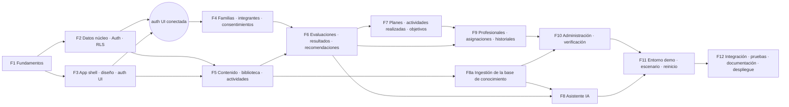

# Plan de implementación

## 1. Criterio general

**Recorridos completos antes que funciones sueltas.** Cada fase termina con algo **demostrable de punta a punta**, con base, API e interfaz, probado y desplegado en `preview`.

El orden sigue las dependencias técnicas reales. Respecto de la secuencia propuesta hubo dos cambios:

1. **Se agregó la fase "Contenido, biblioteca y actividades" (F5) antes de las evaluaciones.** Las recomendaciones (F6), los planes (F7), la base de conocimiento del asistente (F8) y la demo dependen de que el contenido esté cargado y versionado.
2. **Los datos de demostración se construyen de a poco.** Cada fase agrega sus _fixtures_ a `scripts/demo/fixtures/`, y F11 solo arma el escenario completo, el entorno aislado y el reinicio. Así la demo no queda para el final, cuando sería un riesgo.



**Camino crítico:** F1 → F2 → F4 → F6 → F7 → F9 → F10 → F11 → F12.
**En paralelo:** F3 (con F2), F5 (con F4) y F8a (desde F5).

## 2. Cronograma de referencia (una semana intensiva)

| Día | Camino crítico                                | En paralelo                                                | Equipo humano (sin código)                                                                                                                    |
| --- | --------------------------------------------- | ---------------------------------------------------------- | --------------------------------------------------------------------------------------------------------------------------------------------- |
| 1   | F1 completa · F2 migraciones 0001–0003        | F3 sistema de diseño y layouts                             | Conseguir las credenciales de Google y GitHub OAuth, la clave de Anthropic, Voyage y Resend; crear los proyectos `crecer-dev` y `crecer-demo` |
| 2   | F2 tests RLS · F4                             | F3 pantallas de auth conectadas · F5 migraciones 0004–0005 | Redactar o revisar las preguntas del cuestionario v1 y 16 actividades más (llegar a 30)                                                       |
| 3   | F6                                            | F5 biblioteca y actividades (interfaz) · F8a ingestión     | Escribir el banco de evaluación de la IA (100 preguntas, 20 de riesgo)                                                                        |
| 4   | F7 · F9 (base y RPC)                          | F8 asistente                                               | Verificar las líneas de ayuda (102, 137, 135, 911, 107) y los recursos de Mar del Plata                                                       |
| 5   | F9 (interfaz profesional y familiar)          | F8 evaluación y ajuste                                     | Guion de la demo, cartelería y video de respaldo                                                                                              |
| 6   | F10 · F11                                     | Corrección de errores                                      | Ensayo 1 del guion                                                                                                                            |
| 7   | F12: E2E, despliegue web, APK y congelamiento | —                                                          | Ensayos 2 y 3, plan B                                                                                                                         |

**Si el plan se atrasa, se recorta en este orden** (sin tocar la seguridad ni las pruebas de autorización):

1. Citas y disponibilidad (P1).
2. Interfaz de notificaciones (queda solo el contador).
3. Editor de contenidos en la administración (el contenido se carga desde `content/`).
4. Generador de planes por reglas (pasa a una plantilla fija por edad).
5. Página de uso y costos en la administración (pasa a una consulta SQL documentada).
6. Inicio de sesión con GitHub (Google y correo alcanzan para la demo).

---

## 3. Fases

Complejidad: **S** (≤ ½ día) · **M** (½–1 día) · **L** (1–1½ días) · **XL** (> 1½ días).

### F1 · Fundamentos, repositorio y herramientas

1. **Objetivo.** Un monorepo funcionando con calidad automatizada desde el primer commit.
2. **Funcionalidades:**
   - Mover el clon fuera de OneDrive (`C:\dev\Proyecto-Final`).
   - Activar pnpm con Corepack.
   - Workspaces y Turborepo.
   - TypeScript estricto (base + referencias), ESLint (flat config, `typescript-eslint` strict, `import`, `react-hooks`, `jsx-a11y` donde aplica), Prettier, EditorConfig.
   - Husky + lint-staged (Prettier en pre-commit; lint, tipos y tests en pre-push) + commitlint (Conventional Commits) + gitleaks.
   - Esqueletos vacíos de `apps/app` (`create-expo-app` con Expo Router y TS), `apps/api` (Hono), `packages/shared`, `packages/domain` y `packages/config`.
   - `.env.example` y validación zod de las variables de entorno en la app y la API.
   - Workflow `ci.yml`: install → lint → typecheck → test → build.
   - Copiar la investigación a `docs/research/`.
   - `README.md` raíz con los comandos.
3. **Dependencias.** Ninguna.
4. **Archivos o módulos:**
   - `package.json`, `pnpm-workspace.yaml`, `turbo.json`, `.npmrc`.
   - `packages/config/{tsconfig.base.json,eslint.config.js,prettier.config.js}`.
   - `apps/app/src/app/_layout.tsx`, `apps/api/src/app.ts` con `GET /v1/health`.
   - `.github/workflows/ci.yml`, `.gitignore`, `.husky/`, `docs/research/crecer_en_casa_investigacion.md`.
5. **Criterios de aceptación:**
   - `pnpm i && pnpm lint && pnpm typecheck && pnpm test` en verde, localmente y en CI.
   - `pnpm dev` levanta la app web y la API (`/v1/health` → 200).
   - Un commit con un mensaje inválido es rechazado.
   - gitleaks detecta un secreto de prueba.
6. **Pruebas.** Test de humo de `health`. Test de que `packages/domain` no importa React ni Supabase (regla de ESLint).
7. **Riesgos:**
   - Problemas de pnpm con Metro (Expo). Mitigación: la guía de monorepos de Expo vigente; si falla, `node-linker=hoisted`.
   - Windows: rutas largas (`git config core.longpaths true`).
8. **Resultado verificable.** CI en verde en GitHub, primer PR mergeado en `main` y la app web "Hola" desplegada en una vista previa de Vercel.
9. **Complejidad.** M.
10. **Paralelismo.** Es la base de todo: no hay nada en paralelo, salvo las gestiones de cuentas del equipo humano.

### F2 · Datos núcleo, autenticación y autorización

1. **Objetivo.** Identidad, roles, familias y RLS funcionando y **probados** antes de construir pantallas encima.
2. **Funcionalidades:**
   - Migraciones 0001 (extensiones, auditoría y helpers), 0002 (identidad y acceso) y 0003 (familias y consentimientos).
   - `seed.sql` con roles, permisos y configuración.
   - Trigger que crea el `profile` cuando se registra un usuario.
   - `has_permission()`, `is_family_adult()`, `create_family()`, `accept_family_invitation()`.
   - Supabase Auth: correo con verificación, Google y GitHub (PKCE), URL de redirección en la lista blanca y SMTP de Resend.
   - Middleware de la API: `requireAuth` (verificación del JWT), `requirePermission` y `requireFamilyRole`, errores uniformes y `requestId`.
   - Generación de tipos (`supabase gen types`) hacia `packages/shared`.
3. **Dependencias.** F1.
4. **Archivos o módulos:**
   - `supabase/migrations/0001…0003_*.sql`, `supabase/seed.sql`, `supabase/tests/{identity,families}.test.sql`.
   - `apps/api/src/middleware/{auth,permissions,errors,requestId}.ts`, `apps/api/src/lib/{supabase,env,logger}.ts`.
   - `packages/shared/src/{db.types.ts,permissions.ts,errors.ts}`.
5. **Criterios de aceptación:**
   - RLS está habilitado en todas las tablas (lo verifica un test que consulta `pg_tables`).
   - El usuario A no puede leer ni escribir los datos de la familia B.
   - `caregiver` no puede editar integrantes.
   - No se puede eliminar al último `owner`.
   - Un usuario no puede asignarse roles.
   - La API rechaza un JWT inválido o vencido (401) y la falta de permiso (403).
6. **Pruebas:**
   - pgTAP, con unos 40 casos positivos y negativos.
   - Vitest de los middlewares con JWT de prueba.
7. **Riesgos:**
   - No hay Docker local: los tests de RLS corren en CI con `supabase start`, o se instala Docker Desktop.
   - Errores sutiles de recursión en RLS: se previenen con los helpers `SECURITY DEFINER`.
8. **Resultado verificable.** El job `db-test` de CI en verde, más una demostración por curl: login → JWT → `GET` con RLS.
9. **Complejidad.** L.
10. **Paralelismo.** F3 puede avanzar con datos simulados. F5 puede empezar sus migraciones (0004–0005) en cuanto 0001 esté mergeada.

### F3 · Estructura de la app, sistema de diseño y pantallas de autenticación

1. **Objetivo.** El esqueleto navegable en web y Android, con identidad visual y autenticación completa.
2. **Funcionalidades:**
   - NativeWind y tokens con tema claro, oscuro y del sistema.
   - Fuentes Fraunces y Atkinson.
   - Componentes base: `Button`, `IconButton`, `TextField`, `Select`, `Checkbox`, `RadioGroup`, `Card`, `EvidenceChip`, `Badge`, `Skeleton`, `EmptyState`, `ErrorState`, `Toast`, `Dialog`, `Tabs`, `GrowthLine`, `DataTable` (web) / `DataList` (nativo).
   - Layouts adaptables (tabs, riel o barra lateral) y grupos de rutas con guardas.
   - Selector de espacio.
   - Pantallas de ingreso, registro, recuperación, nueva contraseña y callback de OAuth (web y deep link nativo).
   - Sesión: SecureStore en nativo.
   - TanStack Query con el manejo de errores estándar.
   - Sentry inicializado sin datos personales.
3. **Dependencias.** F1. La conexión de auth depende de F2.
4. **Archivos o módulos:**
   - `apps/app/src/ui/**`, `apps/app/src/lib/{supabase,api,query,sentry}.ts`, `apps/app/src/features/auth/**`.
   - `apps/app/src/app/(auth)/**`, `apps/app/src/app/{(family),(pro),(admin)}/_layout.tsx`.
5. **Criterios de aceptación:**
   - Registro, verificación e ingreso con correo, Google y GitHub funcionan en la web y en un build de desarrollo de Android.
   - Una ruta protegida sin sesión redirige al login y vuelve a la ruta original después de ingresar.
   - Al cambiar el tema, todas las pantallas se ven correctas.
   - axe no informa infracciones graves en las pantallas de auth.
6. **Pruebas.** Componentes con jest-expo y Testing Library (`Button`, `TextField` con errores). Playwright del flujo de registro e ingreso con correo, usando un usuario de prueba de `dev`.
7. **Riesgos:**
   - El OAuth en nativo (deep links y esquema) suele llevar tiempo: hay que reservarle medio día.
   - NativeWind con el tema oscuro en la web: se verifica temprano.
8. **Resultado verificable.** Video corto: login con Google en el celular Android y en la web, con cambio de tema.
9. **Complejidad.** L.
10. **Paralelismo.** Los componentes de UI se hacen en paralelo con F2. Las pantallas de auth requieren F2.

### F4 · Familias, integrantes y consentimientos

1. **Objetivo.** La unidad familiar completa: varios adultos, varios integrantes, invitaciones y consentimientos.
2. **Funcionalidades:**
   - Crear una familia (RPC).
   - Agregar, editar o archivar integrantes (apodo y mes/año).
   - Preferencias.
   - Invitar adultos por correo (API + Resend) y aceptar la invitación.
   - Cambiar roles y quitar adultos.
   - Consentimientos `terms_privacy` y `child_data` con versión de política.
   - Pantallas `familia/*`, `privacidad` (consentimientos) y `hoy` (vacía).
   - Auditoría de cada operación.
3. **Dependencias.** F2 y F3.
4. **Archivos o módulos:**
   - `apps/app/src/features/families/**`, `apps/app/src/app/(family)/{familia,privacidad,hoy}*`.
   - `apps/api/src/modules/families/invitations.ts`, `packages/shared/src/schemas/family.ts`.
   - `supabase/tests/families_flows.test.sql`, `scripts/demo/fixtures/families.ts`.
5. **Criterios de aceptación:**
   - Un owner crea una familia con 2 integrantes e invita a un guardian y a un caregiver, que aceptan y ven lo que les corresponde según la matriz.
   - Una invitación vencida o reutilizada falla.
   - Sin el consentimiento `child_data`, no se puede crear un integrante.
6. **Pruebas:**
   - pgTAP de la matriz de familia.
   - Vitest del endpoint de invitaciones (correo simulado).
   - E2E: crear una familia → invitar → aceptar en otro contexto del navegador.
7. **Riesgos:**
   - Correo: los límites de Resend en el plan gratuito y la verificación del dominio. Sin dominio, en `dev` se usa la dirección de prueba de Resend **[A verificar]**.
8. **Resultado verificable.** El recorrido de una familia con tres adultos funciona en `preview`.
9. **Complejidad.** M.
10. **Paralelismo.** F5 avanza en paralelo.

### F5 · Contenido, biblioteca pública y catálogo de actividades

1. **Objetivo.** Convertir la investigación en contenido estructurado y navegable, y armar un catálogo de actividades útil.
2. **Funcionalidades:**
   - Migraciones 0004–0005.
   - `content/` con:
     - `sources.yaml` (las 18 fuentes de la §27).
     - 5 etapas por edad.
     - 9 fichas A–I.
     - "Cuándo consultar".
     - Glosario.
     - **30 actividades** (las 14 de la §12 + 16 nuevas).
   - Script `pnpm content:sync` (idempotente, valida el frontmatter con zod).
   - Pantallas públicas: inicio por edad, etapas, situaciones, cuándo consultar, evidencia y actividades con filtros (edad, duración, espacio, costo, categoría, "sin materiales") y búsqueda de texto completo.
   - Favoritos de la familia (`saved_activities`) y "la hicimos" (`activity_logs` con participantes).
3. **Dependencias.** F2 (migraciones) y F3 (interfaz). Los favoritos requieren F4.
4. **Archivos o módulos:**
   - `supabase/migrations/0004_content_sources.sql`, `0005_activities_plans_goals.sql`.
   - `content/**`, `scripts/content-sync.ts`, `packages/shared/src/schemas/content.ts`.
   - `apps/app/src/app/(public)/**`, `apps/app/src/features/{library,activities}/**`.
5. **Criterios de aceptación:**
   - Todo contenido publicado muestra su etiqueta de evidencia y sus fuentes.
   - Los filtros responden en menos de 1 s con 30 actividades (objetivo de la §23 con 80).
   - Las páginas públicas se ven sin sesión y se indexan (HTML estático con `<title>` y meta description).
6. **Pruebas:**
   - Validación del contenido (todo `content/` pasa el esquema en CI).
   - Test de filtros en SQL.
   - E2E de búsqueda y filtrado.
   - axe en la ficha y en el catálogo.
7. **Riesgos:**
   - El contenido no tiene revisión clínica. Mitigación: en `demo` se muestra el aviso "Contenido en revisión profesional" y en `prod` nada se publica sin `reviewed_by`.
8. **Resultado verificable.** Biblioteca y catálogo públicos navegables en `preview`.
9. **Complejidad.** L. Buena parte es trabajo de contenido.
10. **Paralelismo.** En paralelo con F4. F8a (ingestión) puede empezar cuando haya contenido en la base.

### F6 · Evaluaciones, resultados y recomendaciones

1. **Objetivo.** Una evaluación orientativa, reproducible y explicada, con un historial por integrante.
2. **Funcionalidades:**
   - Migración 0006.
   - Cuestionario v1 en `content/questionnaires/habitos-v1.yaml` (ver §4).
   - `packages/domain/scoring`: motor de reglas puro (`scoreAttempt`, `recommend`) con `engine_version`.
   - Endpoint `submit` y RPC `finalize_assessment`.
   - Interfaz: responder (autoguardado y preguntas condicionales por edad), resultado (bandas, por qué y recomendaciones) e historial (línea temporal por dimensión).
   - Estados de las recomendaciones (aceptar, descartar o hecha).
3. **Dependencias.** F4 (integrantes) y F5 (contenidos y actividades a recomendar).
4. **Archivos o módulos:**
   - `supabase/migrations/0006_questionnaires_assessments.sql`.
   - `packages/domain/src/scoring/{engine.ts,spec.schema.ts,recommend.ts}` + tests.
   - `apps/api/src/modules/assessments/**`, `apps/app/src/features/assessments/**`.
5. **Criterios de aceptación:**
   - Las mismas respuestas dan el **mismo** resultado (test de propiedad).
   - Una versión publicada no se puede editar (trigger).
   - Un intento enviado no acepta más respuestas.
   - El resultado nunca usa vocabulario clínico (test sobre los textos).
   - El historial muestra la diferencia con el intento anterior.
6. **Pruebas:**
   - Unidad del motor con más de 30 casos (bordes de bandas, preguntas por edad, respuestas faltantes).
   - pgTAP de inmutabilidad.
   - Integración del `submit` (pertenencia, idempotencia y 409).
   - E2E de responder → resultado.
7. **Riesgos:**
   - El cuestionario no está validado. Mitigación: etiqueta `propuesta_proyecto`, aviso fijo y revisión profesional pendiente.
8. **Resultado verificable.** Dos intentos sobre un integrante con su historial visible.
9. **Complejidad.** L.
10. **Paralelismo.** El motor (`packages/domain`) se programa y prueba en paralelo con F4 y F5, porque es lógica pura.

### F7 · Planes familiares, actividades realizadas y objetivos

1. **Objetivo.** Pasar del resultado a la acción: un plan semanal posible y objetivos con avance.
2. **Funcionalidades:**
   - `packages/domain/plans`: generador por reglas. Usa como entradas la edad, las preferencias (minutos por día, espacio, presupuesto e intereses), las recomendaciones activas y las actividades ya hechas (para variar). La salida son 5 a 7 ítems por semana, sin repetir la misma actividad más de 2 veces, y siempre con una opción de 10 minutos sin materiales.
   - `POST /v1/plans/generate`.
   - Plan editable (cambiar, quitar o "otra idea").
   - Marcar como hecho con participantes y una valoración opcional.
   - `follow_up_goals` y `goal_progress_entries` desde la familia, incluido "convertir una recomendación en objetivo".
   - La tarjeta **Hoy**.
3. **Dependencias.** F5 y F6.
4. **Archivos o módulos:**
   - `packages/domain/src/plans/**`, `apps/api/src/modules/plans/**`.
   - `apps/app/src/features/{plans,goals}/**`, `apps/app/src/app/(family)/{hoy,actividades/*}`.
5. **Criterios de aceptación:**
   - El plan respeta las restricciones (tiempo, espacio y edad) en el 100% de los casos de prueba.
   - Al marcar una actividad, se actualizan "Hoy" y el historial.
   - Los objetivos muestran su avance.
6. **Pruebas.** Unidad del generador (restricciones y variedad) y E2E de generar → marcar como hecho.
7. **Riesgos.** Planes repetitivos con un catálogo de 30 actividades. Mitigación: priorizar la variedad por categoría y admitir repeticiones.
8. **Resultado verificable.** Una semana planificada con avance visible.
9. **Complejidad.** M.
10. **Paralelismo.** En paralelo con F8.

### F8a · Ingestión de la base de conocimiento · F8 · Asistente con IA

1. **Objetivo.** El asistente RAG con citas, contexto autorizado y seguridad, evaluado con el banco de preguntas.
2. **Funcionalidades:**
   - **F8a:**
     - Migración 0008.
     - `kb_hybrid_search`.
     - Pipeline: normalizar → fragmentar → embeddings → insertar.
     - Script `pnpm kb:ingest` + endpoint de administración.
     - Proveedores falsos para los tests.
   - **F8:**
     - Migración 0009.
     - `LlmProvider` (Anthropic) y `EmbeddingProvider` (Voyage).
     - Filtro de riesgo (`packages/domain/safety`).
     - ContextBuilder, PromptBuilder `assistant.v1` y post-chequeo.
     - SSE.
     - Cuotas y presupuesto.
     - Retención con `pg_cron`.
     - Consentimientos `ai_personal_context` y `chat_history`.
     - Interfaz de conversaciones (citas, tarjeta de riesgo, retención y borrado).
     - Banco de evaluación y script `pnpm ai:eval`.
3. **Dependencias.** F5 (contenido) para F8a. F6 y F7 para el contexto personalizado de F8.
4. **Archivos o módulos:**
   - `supabase/migrations/0008_knowledge_base.sql`, `0009_assistant.sql`.
   - `apps/api/src/ai/{providers,prompts,retrieval,safety,context}/**`, `apps/api/src/modules/{kb,assistant}/**`.
   - `packages/domain/src/safety/**`, `apps/api/eval/{questions.yaml,rubric.md,reports/}`.
   - `apps/app/src/features/assistant/**`.
5. **Criterios de aceptación:**
   - Se cumplen los umbrales de `AI_ARCHITECTURE.md` §10. En Expotec alcanza el subconjunto de 50 preguntas (las 20 de riesgo + 30), con el banco completo antes de cualquier uso real.
   - Los casos de riesgo nunca llegan al modelo (lo verifica un test con un proveedor espía).
   - Ninguna clave aparece en el cliente.
   - Al cortar el proveedor de embeddings, la búsqueda sigue funcionando en modo degradado.
6. **Pruebas:**
   - Unidad del filtro de riesgo (más de 100 variantes), del post-chequeo y del armado del prompt (_snapshot_).
   - Integración con los proveedores falsos.
   - Pruebas de la búsqueda híbrida con fixtures.
   - Evaluación manual con el proveedor real.
7. **Riesgos:**
   - Latencia o costo de Opus. Mitigación: `effort low`, caché y ADR-009.
   - Calidad de la recuperación con poco contenido. Mitigación: la referencia de contexto largo.
   - Límite de tiempo de las funciones serverless. Mitigación: streaming y verificación temprana del límite.
8. **Resultado verificable.** Una conversación con contexto que cita fichas, una pregunta de riesgo que deriva y el informe de la evaluación guardado.
9. **Complejidad.** XL.
10. **Paralelismo.** F8a en paralelo con F6 y F7. El filtro de riesgo (lógica pura) se puede programar desde el día 2.

### F9 · Profesionales, asignaciones e historiales

1. **Objetivo.** El módulo profesional completo y funcional, con permisos granulares y auditados.
2. **Funcionalidades:**
   - Migración 0007.
   - Perfil profesional: especialidades, formación, experiencia, modalidad, contacto y zona.
   - Credenciales declaradas con archivo en Storage y "enviar a verificación".
   - Directorio con filtros (especialidad, modalidad y ciudad), solo de verificados.
   - El asistente de 3 pasos "compartir con un profesional" (`request_care` + consentimientos).
   - Bandeja de solicitudes y aceptar o rechazar.
   - Vista de casos.
   - `pro_member_overview` (auditada).
   - Observaciones privadas o compartidas.
   - Objetivos propuestos por el profesional y registro de avance.
   - Finalizar el acompañamiento.
   - Revocar permisos y ver la actividad de acceso desde la familia.
   - Notificaciones en la aplicación de estos eventos.
3. **Dependencias.** F4, F6 y F7 (objetivos).
4. **Archivos o módulos:**
   - `supabase/migrations/0007_professionals_care.sql`, `supabase/tests/professionals_scopes.test.sql`.
   - `apps/app/src/app/(pro)/**`, `apps/app/src/app/(family)/profesionales/**`, `apps/app/src/features/professionals/**`.
5. **Criterios de aceptación** (escenario de la §8 de `DATABASE.md`):
   - La psicopedagoga ve solo a Sofi; el pediatra, solo a Tomi.
   - Al revocar un permiso, el acceso se pierde al instante.
   - Toda lectura de un resumen genera una entrada en la auditoría.
   - Un profesional no verificado no aparece en el directorio y su perfil lo dice claramente.
6. **Pruebas.**
   - pgTAP: la matriz completa de alcances (2 familias, 3 profesionales, revocación y finalización).
   - E2E: solicitar → aceptar → observar → revocar.
7. **Riesgos.**
   - Es el módulo con más reglas. Mitigación: las reglas viven en la base, están probadas y las pantallas son simples.
   - Cuestiones legales sobre las observaciones. Mitigación: solo datos ficticios hasta tener el dictamen.
8. **Resultado verificable.** Los recorridos familia ↔ dos profesionales funcionan con los permisos correctos.
9. **Complejidad.** XL.
10. **Paralelismo.** Las pantallas del profesional y las de la familia se pueden hacer en paralelo una vez estén las RPC.

### F10 · Administración y verificación

1. **Objetivo.** Operar la plataforma sin acceder a los datos sensibles.
2. **Funcionalidades:**
   - Inicio del panel (pendientes, uso y errores).
   - Usuarios y roles (con MFA requerido para los roles administrativos).
   - Cola de verificación: ver la credencial (URL firmada), checklist (REFEPS/SISA o colegio), aprobar, rechazar o pedir información → `verify_credential`.
   - Catálogos (especialidades y categorías).
   - Contenidos y actividades: listar, cambiar de estado y publicar o archivar. La edición completa es P1.
   - Cuestionarios: ver versiones y publicar una nueva.
   - Base de conocimiento: subir, ingerir, aprobar y retirar.
   - Auditoría (filtros por acción, actor y fecha).
   - Uso de la IA y costo del mes.
   - Configuración (`app_settings`).
3. **Dependencias.** F8a y F9.
4. **Archivos o módulos.** `apps/app/src/app/(admin)/**`, `apps/api/src/modules/admin/**` y `supabase/tests/admin.test.sql`.
5. **Criterios de aceptación:**
   - Un `credential_verifier` aprueba una credencial y el perfil pasa a "Matrícula verificada el …".
   - Un `content_editor` no puede publicar.
   - **Ningún rol administrativo puede leer conversaciones, respuestas ni observaciones** (test negativo).
6. **Pruebas.** pgTAP de los permisos administrativos, integración de `verify` y E2E de la cola de verificación.
7. **Riesgos.** La experiencia de las tablas en react-native-web. Mitigación: un `DataTable.web.tsx` dedicado.
8. **Resultado verificable.** Las verificaciones y la auditoría se muestran desde la cuenta de administración.
9. **Complejidad.** L.
10. **Paralelismo.** La auditoría y la configuración son independientes de la verificación.

### F11 · Entorno de demostración, escenario y reinicio

1. **Objetivo.** La demo reproducible en minutos, aislada y segura (`EXPOTEC_DEMO.md`).
2. **Funcionalidades:**
   - Proyecto `crecer-demo` con las migraciones aplicadas.
   - Despliegue `demo` con `APP_ENV=demo` y el banner.
   - `pnpm demo:reset` con sus guardas, usuarios ficticios, UUID deterministas, el escenario completo y las contraseñas generadas.
   - `pnpm demo:capture` para grabar una conversación real de ensayo.
   - Perfiles de navegador o dispositivos ya ingresados.
   - Checklist del día.
3. **Dependencias.** F4 a F10 (sus fixtures).
4. **Archivos o módulos.** `scripts/demo/{reset.ts,seed.ts,capture.ts,guards.ts,fixtures/**}` y `docs/planning/EXPOTEC_DEMO.md` (actualizado con los resultados del ensayo).
5. **Criterios de aceptación:**
   - `demo:reset` deja el entorno en el estado exacto en menos de 2 minutos.
   - Ejecutarlo contra `dev` o `prod` **falla**.
   - El guion se completa en menos de 8 minutos.
6. **Pruebas.**
   - Test de las guardas (variables de entorno incorrectas → aborta).
   - E2E "smoke-demo" que recorre los 7 puntos contra `demo`.
7. **Riesgos.** El Wi-Fi de la exposición. Mitigación: hotspot del celular, video de respaldo y proveedores falsos activables solo en `demo`, con un aviso visible "respuesta de ensayo".
8. **Resultado verificable.** Tres ensayos cronometrados.
9. **Complejidad.** M.
10. **Paralelismo.** Los fixtures se escriben en cada fase; el ensamblado es secuencial.

### F12 · Integración, pruebas, documentación y despliegue

1. **Objetivo.** Calidad de entrega: todo probado, documentado y publicado.
2. **Funcionalidades:**
   - Suite E2E completa (web), con axe en las pantallas P0.
   - Revisión manual con TalkBack.
   - Build EAS `preview` (APK).
   - Despliegue `demo` y `prod` (bloqueado).
   - OpenAPI generado en `docs/api/`.
   - `README` y `docs/ARCHITECTURE` actualizados con lo construido.
   - Guía de defensa técnica ("cómo funciona por dentro": RLS, RAG y puntuación).
   - Plan de incidentes.
   - Prueba de restauración de un backup.
   - Etiqueta `v1.0.0-expotec`.
3. **Dependencias.** Todas.
4. **Archivos o módulos.** `e2e/**`, `docs/{DEFENSA_TECNICA.md,security/INCIDENT_RESPONSE.md,api/openapi.json}` y `CHANGELOG.md`.
5. **Criterios de aceptación:**
   - CI en verde.
   - 0 errores críticos abiertos.
   - Lighthouse (web) con accesibilidad ≥ 90 en las páginas públicas.
   - APK instalado en 2 dispositivos.
   - La documentación refleja el sistema real (no el plan).
6. **Pruebas.** Todo `TEST_STRATEGY.md`.
7. **Riesgos.** Las regresiones de último momento. Mitigación: congelar funciones el día 6 a la noche y aceptar solo correcciones.
8. **Resultado verificable.** El release etiquetado y la demo funcionando desde la URL pública y el APK.
9. **Complejidad.** M.
10. **Paralelismo.** La documentación y las pruebas manuales se reparten entre los integrantes del equipo.

---

## 4. Borrador del cuestionario v1: "Hábitos digitales y rutinas familiares"

> Etiqueta: `propuesta_proyecto`. **No es un instrumento validado.** Se basa en las pautas de la OMS 2019 y 2020, la SAP y las 5 C de la AAP 2026, según la investigación. Requiere revisión profesional. Lo responde un adulto sobre **un integrante**, en 5 a 7 minutos.

| Dimensión (código)  | Preguntas (resumen)                                                                                                                                            | Edad aplicable       |
| ------------------- | -------------------------------------------------------------------------------------------------------------------------------------------------------------- | -------------------- |
| `sueno`             | Horas de sueño habituales (comparadas con la recomendación por edad) · ¿hay pantallas en la hora previa a dormir? · ¿dispositivos en el dormitorio a la noche? | Todas                |
| `movimiento`        | Tiempo de juego activo por día · tiempo seguido sentado o sujeto · (bebés) momentos de piso por día                                                            | Todas, con variantes |
| `pantalla_tiempo`   | Tiempo de pantalla recreativa en un día de semana y en el fin de semana (comparado con la OMS y la SAP para menores de 5 años; para mayores, solo descriptivo) | Todas                |
| `pantalla_contexto` | TV de fondo · ¿ven juntos o conversan sobre lo que ve? · ¿contenido elegido para su edad? · ¿reproducción automática desactivada? · pantallas en las comidas   | Todas                |
| `calma`             | ¿Con qué frecuencia el dispositivo es la forma de calmarlo? · ¿qué otras estrategias funcionan? (selección múltiple) · ¿cómo reacciona al apagar?              | 1–12 años            |
| `acuerdos`          | ¿Hay acuerdos claros sobre cuándo y dónde? · ¿los adultos también los cumplen? · ¿se revisan? · (9 a 17 años) ¿participó al armarlos?                          | Desde los 3 años     |

**Especificación de puntuación (fragmento ilustrativo de `scoring_spec`):**

```json
{
  "engineVersion": "1.0.0",
  "dimensions": [
    {
      "code": "sueno",
      "questions": ["sleep_hours", "screens_before_bed", "device_in_bedroom"],
      "aggregate": "mean",
      "bands": [
        { "max": 39, "band": "priority" },
        { "max": 69, "band": "watch" },
        { "max": 100, "band": "strength" }
      ]
    }
  ],
  "questionScoring": {
    "sleep_hours": {
      "type": "age_range",
      "ranges": [
        { "ageMonths": [12, 35], "ideal": [11, 14] },
        { "ageMonths": [36, 59], "ideal": [10, 13] },
        { "ageMonths": [60, 155], "ideal": [9, 11] },
        { "ageMonths": [156, 215], "ideal": [8, 10] }
      ],
      "inside": 100,
      "offByOne": 60,
      "offMore": 20
    },
    "screens_before_bed": { "type": "option_value" }
  },
  "recommendations": [
    {
      "code": "sleep_devices_out",
      "when": {
        "dimension": "sueno",
        "bandIn": ["priority", "watch"],
        "answer": { "device_in_bedroom": "yes" }
      },
      "target": { "contentSlug": "sueno-y-pantallas" },
      "priority": 1
    },
    {
      "code": "turn_off_transitions",
      "when": { "answer": { "reaction_turn_off": ["intense", "very_intense"] } },
      "target": { "contentSlug": "ficha-c-reaccion-al-apagar" },
      "priority": 1
    }
  ]
}
```

Las bandas (`strength`, `watch` y `priority`) son **orientativas**. Los cortes son una propuesta del proyecto y se documentan en la ficha "Sobre la evidencia". Los rangos de sueño vienen de la OMS 2019 (1 a 4 años) y de las guías canadienses citadas en la investigación (5 a 17 años).

## 5. Definición de "terminado" (para cualquier tarea)

- [ ] Código tipado, sin `any` implícito; lint y formato aplicados.
- [ ] Validación zod en los límites (formulario y API).
- [ ] RLS y permisos con un test positivo y otro negativo si se tocaron datos.
- [ ] Estados de carga, vacío y error implementados.
- [ ] Accesibilidad: etiquetas, foco y contraste.
- [ ] Tests nuevos en verde; CI en verde.
- [ ] Fixtures de demo actualizados, si aplica.
- [ ] La documentación afectada en `docs/planning/` se actualizó en el mismo PR.
