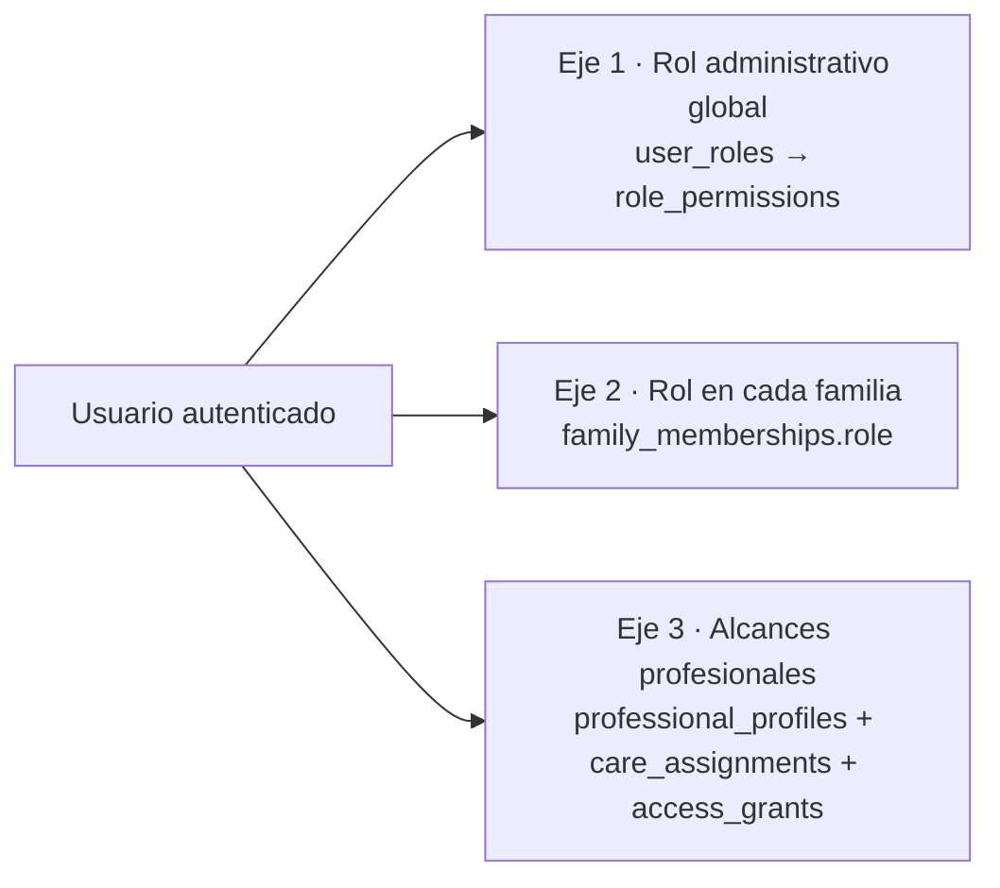
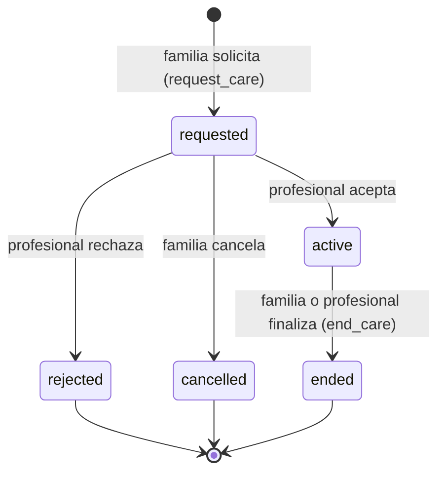

# Roles y permisos

## 1. Modelo: tres ejes independientes

La autorización combina **tres ejes**. Cada uno se guarda en tablas distintas y se evalúa en el servidor, con RLS y en la API.



- Un mismo usuario puede tener los tres ejes, por ejemplo una psicóloga que además es madre y editora voluntaria.
- **Los ejes no se heredan entre sí:** ser administrador no da acceso a los datos de una familia, y ser profesional no da acceso a otras familias.
- La app muestra un **selector de espacio** (Familia, Profesional, Administración) según los ejes que tenga el usuario. Es solo navegación: no otorga permisos.

## 2. Eje 1: roles administrativos y permisos

### 2.1 Catálogo de permisos (`permissions`)

| Código                  | Descripción                                                                              |
| ----------------------- | ---------------------------------------------------------------------------------------- |
| `users.read`            | Ver la lista de usuarios (correo, fecha de alta, roles). **No** ve familias ni contenido |
| `users.manage_roles`    | Asignar y quitar roles administrativos                                                   |
| `users.suspend`         | Suspender o reactivar cuentas (P1)                                                       |
| `content.edit`          | Crear y editar contenidos y actividades en borrador                                      |
| `content.review`        | Marcar como revisado (requiere un perfil profesional verificado o un convenio)           |
| `content.publish`       | Publicar y archivar contenidos y actividades                                             |
| `questionnaires.manage` | Crear versiones y publicarlas                                                            |
| `kb.manage`             | Subir, ingerir, aprobar y retirar documentos de la base de conocimiento                  |
| `catalog.manage`        | Especialidades y categorías                                                              |
| `professionals.verify`  | Revisar credenciales y aprobarlas o rechazarlas                                          |
| `audit.read`            | Leer la auditoría (metadatos, nunca contenido sensible)                                  |
| `usage.read`            | Ver métricas agregadas de uso, costo de IA y errores                                     |
| `settings.manage`       | Editar `app_settings`                                                                    |

### 2.2 Roles (`roles` → `role_permissions`)

| Rol                   | Permisos                                                                                  |
| --------------------- | ----------------------------------------------------------------------------------------- |
| `platform_admin`      | `users.*`, `settings.manage`, `catalog.manage`, `audit.read`, `usage.read`                |
| `content_editor`      | `content.edit`, `questionnaires.manage` (solo borradores), `kb.manage`                    |
| `content_publisher`   | `content.edit`, `content.review`, `content.publish`, `questionnaires.manage`, `kb.manage` |
| `credential_verifier` | `professionals.verify`                                                                    |
| `auditor`             | `audit.read`, `usage.read`                                                                |

**Principios:**

1. **Ningún permiso administrativo da acceso** a conversaciones, respuestas de evaluaciones, observaciones profesionales ni datos de los integrantes. No existe un permiso "ver todo". El acceso de emergencia (_break-glass_) queda en P2 y, si se implementa, exigirá el registro de un motivo, la aprobación de dos personas y una notificación a la familia.
2. Separación de funciones: quien **edita** contenido no lo **publica** si se le asigna solo `content_editor`, y quien **verifica** credenciales no gestiona roles.
3. `users.manage_roles` no permite quitarse el último `platform_admin` (lo controla un trigger).
4. Los administradores y verificadores deben tener **MFA (TOTP)** activo. RLS lo exige leyendo el nivel de autenticación de la sesión (`auth.jwt()->>'aal' = 'aal2'`) en las políticas de escritura administrativa **[A verificar el claim en la Fase 2]**.

## 3. Eje 2: roles dentro de la familia

| Acción                                             | `owner`                                | `guardian`                              | `caregiver`                        |
| -------------------------------------------------- | -------------------------------------- | --------------------------------------- | ---------------------------------- |
| Ver la familia y sus integrantes (apodo y edad)    | ✅                                     | ✅                                      | ✅                                 |
| Editar la familia y las preferencias               | ✅                                     | ✅                                      | ❌                                 |
| Agregar, editar o archivar integrantes             | ✅                                     | ✅                                      | ❌                                 |
| Invitar adultos                                    | ✅ (cualquier rol)                     | ✅ (solo `caregiver`)                   | ❌                                 |
| Cambiar roles o quitar adultos                     | ✅ (no puede quitar al último `owner`) | ❌                                      | ❌                                 |
| Responder evaluaciones y ver resultados            | ✅                                     | ✅                                      | ❌                                 |
| Ver y gestionar recomendaciones y objetivos        | ✅                                     | ✅                                      | 👁 solo los objetivos activos       |
| Actividades: favoritos y planes                    | ✅                                     | ✅                                      | 👁 ver el plan                      |
| Marcar actividades realizadas                      | ✅                                     | ✅                                      | ✅                                 |
| Usar el asistente                                  | ✅                                     | ✅                                      | ❌ (P2: modo general sin contexto) |
| Ver conversaciones con el asistente                | **Solo las propias**                   | **Solo las propias**                    | —                                  |
| Solicitar profesionales, otorgar o revocar accesos | ✅                                     | ✅                                      | ❌                                 |
| Ver observaciones `shared_family`                  | ✅                                     | ✅                                      | ❌                                 |
| Otorgar o revocar consentimientos                  | ✅                                     | ✅ (salvo los de la cuenta del `owner`) | ❌                                 |
| Borrar la familia                                  | ✅                                     | ❌                                      | ❌                                 |

**Conversaciones:** son personales del adulto que las crea. Ni el resto de la familia, ni los profesionales, ni los administradores las ven.

## 4. Eje 3: alcances profesionales (`access_grants.scope`)

| Alcance          | Nivel                      | Qué habilita                                                                                                         |
| ---------------- | -------------------------- | -------------------------------------------------------------------------------------------------------------------- |
| `member_profile` | Integrante                 | Apodo, rango de edad e intereses                                                                                     |
| `assessments`    | Integrante                 | Resultados por dimensión, historial y respuestas de las evaluaciones de **ese** integrante                           |
| `goals`          | Integrante                 | Ver objetivos y proponerlos; registrar avances                                                                       |
| `activities`     | Integrante                 | Ver los planes y actividades realizadas donde participa                                                              |
| `observations`   | Integrante                 | Crear observaciones; leer las propias y las `shared_family` de otros profesionales (P2: compartidas entre el equipo) |
| `appointments`   | Integrante o familia       | Gestionar citas (P1)                                                                                                 |
| `family_goals`   | Familia (`member_id` nulo) | Objetivos a nivel familia                                                                                            |
| `family_plans`   | Familia                    | Planes a nivel familia                                                                                               |

**Reglas:**

1. Todo alcance requiere una `care_assignment` en estado **`active`** y un `access_grant` **sin revocar**, respaldado por un `consent` activo con la finalidad `professional_access`.
2. `member_profile` es **requisito** de cualquier otro alcance sobre el mismo integrante (lo valida la RPC `request_care`).
3. **Nunca hay alcance sobre** las conversaciones con el asistente, los datos de otros integrantes, los datos de otros profesionales (salvo las observaciones compartidas), los adultos de la familia (solo el nombre visible del solicitante) ni la auditoría.
4. Al **finalizar** o **cancelar** una asignación, todos sus permisos quedan revocados en la misma transacción. El profesional conserva la **lectura de sus propias observaciones** (posible obligación profesional de conservar registros) **[A validar legalmente]**.
5. **Estado de verificación:** un profesional `unverified` o `pending` puede recibir solicitudes solo si la familia lo invita directamente. **No aparece en el directorio** y su perfil muestra "Credenciales declaradas, no verificadas". Solo los `verified` con `is_listed = true` aparecen en la búsqueda.

### 4.1 Ciclo de vida de una asignación



Que un profesional proponga trabajar con una familia que no lo pidió queda en **P2**: requiere moderación para evitar contactos no deseados.

## 5. Matriz por recurso (resumen)

Leyenda: R = leer, C = crear, U = actualizar, D = borrar o archivar, — = sin acceso.

| Recurso                                          | Visitante                | Adulto owner/guardian                                      | Caregiver             | Profesional (según alcance)             | Admin (según permiso)                                           |
| ------------------------------------------------ | ------------------------ | ---------------------------------------------------------- | --------------------- | --------------------------------------- | --------------------------------------------------------------- |
| Contenido `published` y actividades `published`  | R                        | R                                                          | R                     | R                                       | R (+CUD con `content.*`)                                        |
| Contenido en borrador o revisión                 | —                        | —                                                          | —                     | — (P1: revisor convocado)               | R/CU con `content.edit`                                         |
| `profiles` (propio)                              | —                        | RU                                                         | RU                    | RU                                      | RU                                                              |
| `families`, `family_members`                     | —                        | CRUD                                                       | R                     | R (`member_profile`)                    | —                                                               |
| `family_invitations`                             | —                        | CRD                                                        | —                     | —                                       | —                                                               |
| `consents`                                       | —                        | CR + revocar                                               | —                     | R (los que respaldan sus permisos)      | —                                                               |
| `assessment_attempts` y respuestas               | —                        | CRU (borrador)                                             | —                     | R (`assessments`)                       | —                                                               |
| `assessment_dimension_scores`, `recommendations` | —                        | R (+U del estado de la recomendación)                      | —                     | R (`assessments`)                       | —                                                               |
| `follow_up_goals` y avances                      | —                        | CRUD                                                       | R                     | CRU (`goals` o `family_goals`)          | —                                                               |
| `family_plans`, `plan_items`, `activity_logs`    | —                        | CRUD                                                       | R + marcar como hecho | R (`activities` o `family_plans`)       | —                                                               |
| `conversations`, `messages`                      | —                        | CRUD **las propias**                                       | —                     | —                                       | —                                                               |
| `professional_profiles`                          | R (`verified` y listado) | R (`verified` y listado, más los asignados)                | —                     | CRU el propio                           | R (+U del estado con `professionals.verify`, mediante la API)   |
| `professional_credentials` y archivo             | —                        | —                                                          | —                     | CRU las propias (sin cambiar el estado) | R con `professionals.verify`                                    |
| `credential_verifications`                       | —                        | —                                                          | —                     | R las propias                           | C (mediante la API) con `professionals.verify`                  |
| `care_assignments`, `access_grants`              | —                        | R + RPC                                                    | —                     | R + RPC (responder o finalizar)         | —                                                               |
| `professional_observations`                      | —                        | R (`shared_family`)                                        | —                     | C/R/U las propias (`observations`)      | —                                                               |
| `kb_documents`, `kb_chunks`                      | —                        | —                                                          | —                     | —                                       | CRUD con `kb.manage` (lectura para la búsqueda mediante la API) |
| `audit_log`                                      | —                        | R los eventos de **su familia** (accesos de profesionales) | —                     | R los eventos propios                   | R con `audit.read`                                              |
| `app_settings`                                   | —                        | —                                                          | —                     | —                                       | RU con `settings.manage`                                        |

## 6. Implementación en RLS (patrones)

Las funciones auxiliares son `SECURITY DEFINER`, `STABLE` y con `search_path = ''`, para evitar la recursión entre políticas y que se pueda reemplazar el esquema.

```sql
-- Familia: adultos de la familia leen a los integrantes
create policy family_members_select on public.family_members
for select to authenticated
using (
  public.is_family_adult(family_id)                                    -- cualquier rol de la familia
  or public.pro_has_scope(family_id, id, 'member_profile')             -- profesional autorizado
);

-- Solo owner/guardian modifican integrantes
create policy family_members_write on public.family_members
for update to authenticated
using (public.is_family_adult(family_id, array['owner','guardian']))
with check (public.is_family_adult(family_id, array['owner','guardian']));

-- Resultados: escritura solo por service_role (API) mediante finalize_assessment()
-- No hay política de INSERT/UPDATE para el rol authenticated ⇒ se deniega por defecto.

-- Conversaciones: solo su autor
create policy conversations_owner on public.conversations
for all to authenticated
using (user_id = auth.uid() and public.is_family_adult(family_id, array['owner','guardian']))
with check (user_id = auth.uid() and public.is_family_adult(family_id, array['owner','guardian']));
```

```sql
-- Definición conceptual de pro_has_scope
create function public.pro_has_scope(p_family uuid, p_member uuid, p_scope text)
returns boolean language sql stable security definer set search_path = '' as $$
  select exists (
    select 1
    from public.care_assignments a
    join public.access_grants g on g.assignment_id = a.id
    where a.professional_id = auth.uid()
      and a.family_id = p_family
      and a.status = 'active'
      and g.scope = p_scope
      and g.revoked_at is null
      and g.member_id is not distinct from p_member
  );
$$;
```

**Lecturas sensibles de los profesionales:** las evaluaciones y respuestas de un integrante se leen con la RPC `pro_member_overview(member_id)`, que comprueba los alcances, **escribe en `audit_log`** (`action = 'pro.read.member_overview'`) y devuelve solo las secciones autorizadas. Las tablas de evaluaciones no tienen una política `SELECT` directa para profesionales, así que **no hay forma de leerlas sin dejar rastro**.

## 7. Defensa en profundidad

| Capa          | Control                                                                                                                                                                                                                                                                   |
| ------------- | ------------------------------------------------------------------------------------------------------------------------------------------------------------------------------------------------------------------------------------------------------------------------- |
| App           | Rutas protegidas por grupo (`(family)`, `(pro)`, `(admin)`) con redirección; los botones se ocultan según los permisos. **Es solo para la experiencia de uso**                                                                                                            |
| API           | Middleware `requireAuth` (verifica la firma y la expiración del JWT) → `requirePermission('kb.manage')` o `requireFamilyRole(familyId, [...])` → validación zod → operación con **el cliente del usuario** (RLS) o, si es privilegiada, una RPC limitada a `service_role` |
| Base de datos | RLS en todas las tablas, `REVOKE` por defecto, RPC con verificaciones explícitas, triggers de integridad entre familias                                                                                                                                                   |
| Storage       | El bucket `credentials` permite subir y leer solo en la carpeta `{auth.uid()}/`; los verificadores leen por URL firmada que genera la API (60 segundos)                                                                                                                   |
| Pruebas       | Matriz de autorización automatizada (`TEST_STRATEGY.md` §4): cada fila de la matriz §5 tiene al menos un test positivo y uno negativo en pgTAP                                                                                                                            |

## 8. Eventos auditados (`audit_log.action`)

- `auth.role_granted`, `auth.role_revoked`, `auth.mfa_enrolled`, `account.deleted`, `account.exported`.
- `family.created`, `family.deleted`, `family.member_added`, `family.member_archived`, `family.adult_invited`, `family.adult_joined`, `family.adult_removed`, `family.role_changed`.
- `consent.granted`, `consent.revoked`.
- `care.requested`, `care.accepted`, `care.rejected`, `care.cancelled`, `care.ended`, `grant.revoked`.
- `pro.read.member_overview` (cada acceso), `pro.observation.created`, `pro.observation.updated`.
- `credential.submitted`, `credential.verified`, `credential.rejected`.
- `content.published`, `content.archived`, `questionnaire.published`, `kb.document.ingested`, `kb.document.published`, `kb.document.retired`.
- `settings.updated`, `demo.reset` (en el entorno `demo`).

**Qué guarda cada evento:**

- Actor, contexto del rol, entidad, `family_id` y metadatos **sin contenido sensible**: nunca el texto de una observación ni de un mensaje.
- El hash de la IP con sal.

**Quién lo ve:** la familia, en "Actividad de acceso", ve los eventos que afectan a su familia.
