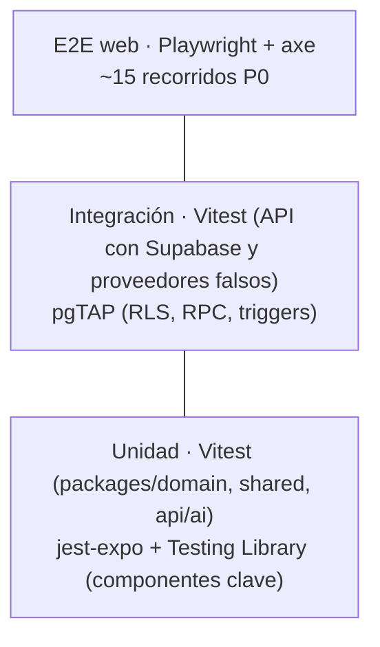
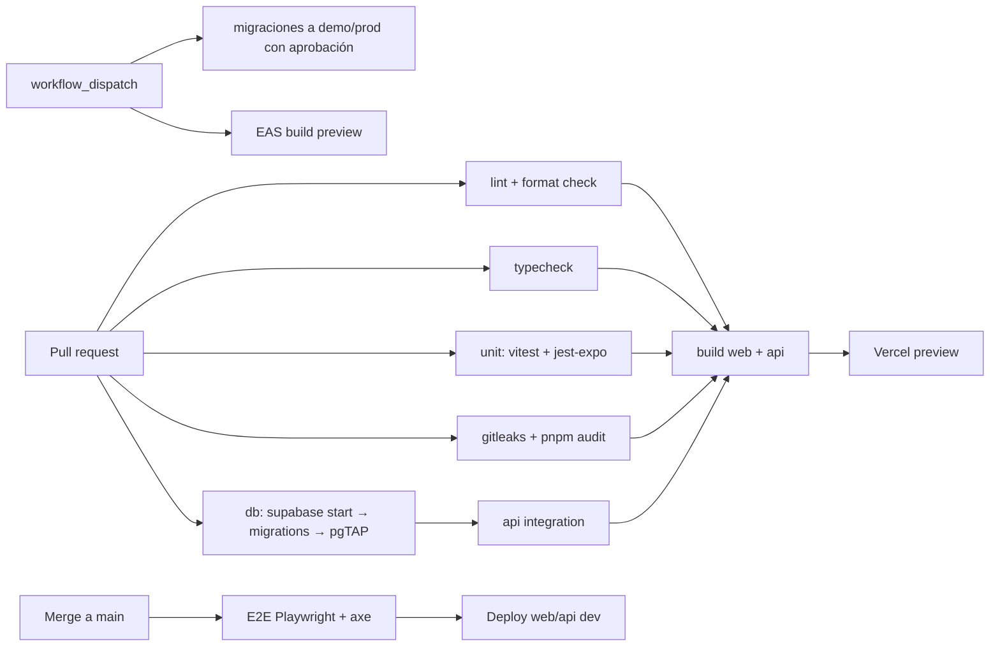

# Estrategia de pruebas y calidad

## 1. Pirámide y herramientas



| Nivel                | Herramienta                                                               | Qué cubre                                                                                                                                                  | Dónde corre                                                                         |
| -------------------- | ------------------------------------------------------------------------- | ---------------------------------------------------------------------------------------------------------------------------------------------------------- | ----------------------------------------------------------------------------------- |
| Unidad (lógica)      | **Vitest**                                                                | Puntuación, recomendaciones, generador de planes, filtro de riesgo, post-chequeo, ContextBuilder, PromptBuilder, esquemas zod, utilidades de fechas y edad | CI en cada PR                                                                       |
| Unidad (UI)          | **jest-expo + @testing-library/react-native**                             | Componentes del sistema de diseño (estados, accesibilidad), formularios con errores, `EvidenceChip`, `GrowthLine`                                          | CI en cada PR                                                                       |
| Base de datos        | **pgTAP** (`supabase test db`)                                            | **Matriz de autorización completa**, RPC, triggers de integridad e inmutabilidad, solo inserción en la auditoría                                           | CI con `supabase start` (Docker en GitHub Actions)                                  |
| Integración API      | **Vitest** + Supabase local + `FakeLlmProvider` y `FakeEmbeddingProvider` | Endpoints: auth, permisos, validación, errores, idempotencia, cuotas, SSE                                                                                  | CI                                                                                  |
| E2E web              | **Playwright** + `@axe-core/playwright`                                   | Recorridos P0 en Chromium (y WebKit en `main`) contra el build web + Supabase local                                                                        | CI en `main` y antes de cada release                                                |
| E2E móvil            | **Maestro** (P1)                                                          | Login, evaluación y asistente en Android                                                                                                                   | Manual o en CI en P1                                                                |
| IA                   | `pnpm ai:eval`                                                            | Banco de 100 preguntas con proveedores reales                                                                                                              | Manual: antes de la demo y con cada cambio de modelo, prompt o base de conocimiento |
| Accesibilidad manual | TalkBack (Android), VoiceOver (web en Safari), teclado                    | Recorridos P0                                                                                                                                              | Antes del release                                                                   |
| Usabilidad           | Pruebas con 5 a 8 personas, tareas y SUS                                  | Recorridos de familia                                                                                                                                      | Después de Expotec (§24 de la investigación)                                        |

**Cobertura objetivo** (como guía, no como meta ciega):

- `packages/domain` ≥ 90%.
- `apps/api` ≥ 70%.
- Cada política RLS con al menos un caso positivo y uno negativo.

## 2. Datos de prueba reproducibles

- **Fábricas** en `packages/shared/test/factories.ts` (familia, integrante, profesional, intento) con UUID y fechas deterministas (reloj inyectable: `now()` se pasa como parámetro a la lógica de dominio).
- Los tests pgTAP crean sus datos dentro de una transacción que se revierte, con usuarios simulados mediante `set local role authenticated` y `set local request.jwt.claims`.
- Los tests de la API reinician la base local antes de cada suite (`supabase db reset` con el seed base).
- Los fixtures de demo (`scripts/demo/fixtures`) **reutilizan** las fábricas: el escenario de la demo también es un caso de prueba.

## 3. Pruebas por módulo (mínimo P0)

| Módulo                | Casos clave                                                                                                                                                                                                                                                                                                                                            |
| --------------------- | ------------------------------------------------------------------------------------------------------------------------------------------------------------------------------------------------------------------------------------------------------------------------------------------------------------------------------------------------------ |
| Auth                  | Registro → verificación → ingreso · JWT vencido o alterado → 401 · OAuth callback con `state` inválido → error · cerrar todas las sesiones                                                                                                                                                                                                             |
| Familias              | Matriz de roles owner, guardian y caregiver · último owner · invitación vencida, reutilizada o de otro correo · sin consentimiento no se puede crear un integrante · aislamiento entre las familias A y B                                                                                                                                              |
| Evaluaciones          | El motor es determinista · bandas en los bordes · preguntas por edad · un intento enviado es inmutable · `submit` de otro usuario → 404 · la versión publicada no se edita · vocabulario no clínico                                                                                                                                                    |
| Actividades y planes  | Filtros combinados · el plan respeta las restricciones · variedad · "la hicimos" con participantes de otra familia → rechazo                                                                                                                                                                                                                           |
| Asistente             | Riesgo → sin llamada al LLM (espía) · citas inválidas eliminadas · patrones prohibidos reemplazados · contexto sin apodos ni datos de otros integrantes (snapshot) · sin consentimiento, sin contexto · cuota 429 · presupuesto agotado → `assistant.enabled=false` · retención por `pg_cron` (llamada a la función de limpieza con un reloj simulado) |
| Profesionales         | Escenario de 2 familias × 3 profesionales · alcance por integrante · revocación inmediata · finalizar revoca todo · `pro_member_overview` registra en la auditoría · un no verificado no aparece en el directorio · observación sin alcance → rechazo                                                                                                  |
| Administración        | Separación de permisos (el editor no publica, el verificador no gestiona roles) · **ningún rol administrativo lee conversaciones, respuestas ni observaciones** · MFA requerido · la auditoría no se puede modificar                                                                                                                                   |
| Demo                  | Las guardas de `demo:reset` abortan si `APP_ENV` es distinto de `demo` o el ref del proyecto no coincide · el reset es idempotente                                                                                                                                                                                                                     |
| Seguridad transversal | RLS habilitado en todas las tablas (consulta a `pg_class.relrowsecurity`) · ninguna función `SECURITY DEFINER` sin `search_path` · el bundle web no contiene `service_role` ni `sk-` · los encabezados CSP y HSTS están presentes                                                                                                                      |

## 4. Matriz de autorización automatizada

Un archivo declarativo, `supabase/tests/authz_matrix.yaml`, enumera **(actor, recurso, operación, esperado)**. Por ejemplo:

```yaml
- actor: caregiver@familiaA
  resource: family_members
  op: update
  target: memberA1
  expect: deny
- actor: pro_psicopedagoga
  resource: rpc.pro_member_overview
  op: execute
  target: memberA2 # Sofi, con alcance
  expect: allow
- actor: pro_psicopedagoga
  resource: rpc.pro_member_overview
  op: execute
  target: memberA1 # Tomi, sin alcance
  expect: deny
```

Un generador convierte el YAML en tests pgTAP. Así la matriz de `ROLES_AND_PERMISSIONS.md` es **ejecutable** y no se desactualiza.

## 5. Recorridos E2E P0 (Playwright)

1. Visitante: inicio → etapa → ficha → actividades con filtros.
2. Registro con correo → verificación (con el servidor de correo de prueba local, Inbucket o Mailpit, que incluye Supabase CLI) → crear familia → agregar integrante.
3. Invitar a un adulto → aceptar en otro contexto → verificar los permisos de caregiver.
4. Responder la evaluación → resultado → recomendación → convertirla en objetivo.
5. Generar el plan → marcar como hecho → la tarjeta Hoy se actualiza.
6. Asistente (con `FakeLlmProvider`): pregunta normal con citas · pregunta de riesgo → tarjeta de ayuda.
7. Compartir con un profesional → aceptar → observación → revocar → el profesional pierde el acceso.
8. Administración: aprobar una credencial → el perfil aparece en el directorio.
9. Borrar la cuenta → los datos ya no existen.
10. Smoke de la demo: los 7 puntos del guion contra `demo` (sin escribir datos).

Cada recorrido ejecuta **axe** en las pantallas que visita y falla ante infracciones `serious` o `critical`.

## 6. Convenciones de código

| Tema         | Regla                                                                                                                                                                                                                                       |
| ------------ | ------------------------------------------------------------------------------------------------------------------------------------------------------------------------------------------------------------------------------------------- |
| TypeScript   | `strict: true`, `noUncheckedIndexedAccess`, `exactOptionalPropertyTypes` (en `shared` y `domain`), `noImplicitOverride`. Sin `any`: se usa `unknown` + zod                                                                                  |
| Nombres      | Archivos `kebab-case.ts`; componentes en `PascalCase.tsx`; hooks `useAlgo.ts`; SQL en `snake_case`; códigos de error en `SCREAMING_SNAKE_CASE`; rutas de la interfaz en español (`/evaluaciones`) y de la API en inglés (`/v1/assessments`) |
| Organización | Por funcionalidad (`features/<modulo>`, `modules/<modulo>`), no por tipo técnico. Un módulo expone un `index.ts` público                                                                                                                    |
| Errores      | Nunca se ignora un `catch`. Los errores de dominio son tipados (`DomainError` con `code`). La API los traduce en un solo middleware                                                                                                         |
| Comentarios  | Explican el **porqué** (decisiones, normas o fuentes), no el qué                                                                                                                                                                            |
| Lint         | `typescript-eslint` strict-type-checked, `eslint-plugin-import` (límites entre paquetes), `react-hooks`, `jsx-a11y` (web) y `eslint-plugin-react-native-a11y` **[A verificar que sea compatible con flat config]**                          |
| Formato      | Prettier (ancho 100, comillas simples, coma final)                                                                                                                                                                                          |
| SQL          | `sqlfluff` con el dialecto `postgres` (P1) y revisión manual en el PR de cada política RLS                                                                                                                                                  |

## 7. Ramas, commits y versionado

- **Ramas:** _trunk-based_ con `main` protegida + ramas cortas `feat/<fase>-<tema>`, `fix/…` y `docs/…`. Todo entra por PR con CI en verde y al menos una revisión (si el equipo tiene más de una persona; si no, autorrevisión con checklist).
- **Commits:** Conventional Commits (`feat(assessments): motor de puntuación v1`), validados con commitlint.
- **Versionado:** SemVer de la app (`1.0.0-expotec`), `engine_version` de la puntuación, `assistant.vN` de los prompts, versiones de cuestionarios en la base y migraciones con timestamp.
- **CHANGELOG** generado a partir de los commits (`changesets` o `release-please`, P1).

## 8. Integración continua



**Revisión automática de código:**

- Las reglas de ESLint funcionan como revisión estática.
- Dependabot para las dependencias.
- El **Security Advisor** de Supabase (avisos de RLS y funciones) se revisa en cada cambio de esquema.
- Opcional: la revisión con Claude Code (`/code-review`) en los PR grandes.

## 9. Documentación de la API

`@hono/zod-openapi` genera `docs/api/openapi.json` a partir de los mismos esquemas zod. En `dev`, `GET /v1/docs` muestra Scalar o Swagger UI. CI falla si el OpenAPI cambió y no se regeneró.

## 10. Criterios de calidad para la entrega a Expotec

- [ ] CI en verde en `main`; 0 tests omitidos sin un issue asociado.
- [ ] La matriz de autorización 100% en verde.
- [ ] Los 10 recorridos E2E en verde, sin infracciones graves de axe.
- [ ] Evaluación de la IA: 50 preguntas (20 de riesgo) con 100% de recall de riesgo, 0 respuestas peligrosas y ≥ 90% de fidelidad.
- [ ] Lighthouse: accesibilidad ≥ 90 y rendimiento ≥ 80 en las páginas públicas (móvil).
- [ ] Revisión manual con TalkBack de 3 recorridos.
- [ ] `demo:reset` + smoke de la demo en verde el día anterior y el mismo día.
