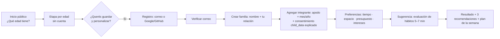

# Experiencia de usuario, diseño y navegación

## 1. Principios de diseño

1. **Una acción posible por pantalla.** Cada pantalla responde a la pregunta "¿qué puedo hacer hoy?" con una acción principal clara. Las secundarias quedan visualmente subordinadas.
2. **Confianza visible.** Las etiquetas de evidencia, las fuentes, las fechas de revisión y el estado de verificación de los profesionales siempre están a la vista, nunca escondidos en "más información".
3. **Sin culpa y sin alarma.** Se usan "Fortaleza", "Para mirar" y "Prioridad sugerida" en lugar de semáforos rojos o puntajes de riesgo. Nada de "adicción", "malcriado" ni "caprichoso". El chico no es "un problema".
4. **Lectura en un vistazo.** Las fichas entran en una pantalla de celular. Primero va lo práctico ("En casa") y después el porqué.
5. **Recursos reales.** Cada sugerencia ofrece una variante "con poco tiempo, sin materiales y en un espacio chico".
6. **Privacidad comprensible.** Antes de compartir algo con un profesional o con la IA, la interfaz muestra **qué**, **con quién** y **cómo se revoca**.
7. **Accesible por defecto.** WCAG 2.2 AA como objetivo, con áreas táctiles de al menos 44×44 pt, texto escalable y sin depender solo del color.
8. **Paneles diferenciados.** La familia, el profesional y la administración ven interfaces distintas, porque sus tareas son distintas.

## 2. Identidad visual

**Concepto: "cuaderno de crianza".** Cálido, editorial y sereno. Más parecido a un buen libro de divulgación que a un dashboard corporativo o a una app infantil.

### 2.1 Tipografía

| Uso              | Familia                              | Motivo                                                                                                                    |
| ---------------- | ------------------------------------ | ------------------------------------------------------------------------------------------------------------------------- |
| Títulos          | **Fraunces** (serif variable, OFL)   | Calidez editorial y personalidad propia; diferencia la marca de las plantillas                                            |
| Texto e interfaz | **Atkinson Hyperlegible Next** (OFL) | Diseñada para la legibilidad y para baja visión: refuerza la accesibilidad del público adulto con cansancio o poco tiempo |
| Números y datos  | Atkinson con cifras tabulares        | Historiales alineados                                                                                                     |

**Escala modular 1,25:** 12 / 14 / 16 (base) / 20 / 25 / 31 / 39. Interlineado de 1,5 en el texto y 1,2 en los títulos. Se respeta el tamaño de fuente del sistema (Dynamic Type y escala de Android) hasta 200%, con layouts que se adaptan en lugar de recortar.

### 2.2 Color: tokens semánticos

Los valores iniciales se validan con una herramienta de contraste en la Fase 3; no se usa ningún color en texto si no cumple AA.

| Token            | Claro                  | Oscuro    | Uso                                                                   |
| ---------------- | ---------------------- | --------- | --------------------------------------------------------------------- |
| `bg`             | `#FBF7F1` (crema)      | `#121816` | Fondo general                                                         |
| `surface`        | `#FFFFFF`              | `#1B2320` | Tarjetas y paneles                                                    |
| `surface-sunken` | `#F3EDE3`              | `#0E1311` | Áreas secundarias                                                     |
| `ink`            | `#1F2A2E`              | `#ECEFEA` | Texto principal                                                       |
| `ink-muted`      | `#55656A`              | `#A7B3AE` | Texto secundario                                                      |
| `primary`        | `#2F6B5A` (verde pino) | `#7FC4AE` | Acciones principales y foco                                           |
| `on-primary`     | `#FFFFFF`              | `#0E1311` | Texto sobre el color principal                                        |
| `accent`         | `#B9582F` (terracota)  | `#E59A78` | Destacados, la "línea de crecimiento"                                 |
| `info`           | `#3D5A80`              | `#9DB7D9` | Información neutra                                                    |
| `caution`        | `#8A5A00`              | `#E8C170` | "Para mirar" (siempre con ícono y texto)                              |
| `danger`         | `#A1262C`              | `#F19A9E` | Solo para errores y riesgo real (nunca para resultados de evaluación) |
| `border`         | `#E2D9CC`              | `#2C3632` | Separadores                                                           |

**Etiquetas de evidencia:** cada una tiene **ícono + texto + color**, y nunca solo color.

| Etiqueta               | Ícono            |
| ---------------------- | ---------------- |
| Recomendación oficial  | Sello            |
| Evidencia consolidada  | Libro            |
| Asociación, no causa   | Flechas cruzadas |
| Hipótesis              | Lamparita        |
| Opinión profesional    | Persona          |
| Propuesta del proyecto | Lápiz            |

### 2.3 Elementos propios (lo que evita el aspecto de plantilla)

- **La "línea de crecimiento":** un trazo orgánico en `accent` que funciona como divisor de secciones, indicador de progreso del cuestionario y línea temporal del historial de evaluaciones.
- **Tarjeta "Hoy":** al entrar, la familia ve **una** sugerencia concreta para el día (actividad del plan o paso de un objetivo) con "Hecho" y "Otra idea".
- **Fichas tipo cuaderno:** encabezado serif, margen izquierdo con la etiqueta de evidencia y bloques "En casa", "Evitar" y "Cuándo consultar" con jerarquía fija.
- **Ilustraciones:** pocas, lineales y monocromáticas en `ink` y `accent`, con personas de distintas edades y configuraciones familiares. No se usan fotos de chicos (coherente con la minimización).
- **Micro-interacciones sobrias:** confirmaciones con un trazo que se completa y un háptico leve en nativo. Respetan "reducir movimiento".

### 2.4 Espaciado, forma y tema

- Escala de espaciado de 4 pt (4, 8, 12, 16, 24, 32, 48, 64). Radios de 8 (controles) y 16 (tarjetas). Sombras mínimas: en modo oscuro se reemplazan por contraste de superficies.
- El tema oscuro se elige como **Sistema, Claro u Oscuro**. Se guarda en `profiles.theme_pref` y, sin sesión, en el dispositivo.

## 3. Layout adaptable

| Ancho                        | Navegación                                         | Contenido                                                                                    |
| ---------------------------- | -------------------------------------------------- | -------------------------------------------------------------------------------------------- |
| < 600 (teléfono)             | **Tabs inferiores** (máximo 5) + pilas             | Una columna                                                                                  |
| 600–1023 (tablet, web chica) | Riel lateral con íconos                            | Una o dos columnas (lista + detalle)                                                         |
| ≥ 1024 (escritorio)          | **Barra lateral** con textos + selector de espacio | Dos o tres columnas; tablas reales en la administración y en la vista de casos profesionales |

Se implementa con `useWindowDimensions` y componentes `Layout` por grupo de rutas. Las diferencias propias de cada plataforma van en `*.web.tsx` y `*.native.tsx`, solo cuando hace falta.

## 4. Mapa de navegación (Expo Router)

Las rutas viven en `apps/app/src/app/`.

```
src/app/
├─ _layout.tsx                       # providers: tema, sesión, query, sentry
├─ (public)/
│  ├─ index.tsx                      # Inicio: "¿Qué edad tiene?" → etapa
│  ├─ etapas/[slug].tsx              # 0–2, 3–5, 6–8, 9–11, 12–17
│  ├─ situaciones/index.tsx          # Fichas A–I
│  ├─ situaciones/[slug].tsx
│  ├─ actividades/index.tsx          # catálogo público con filtros
│  ├─ actividades/[slug].tsx
│  ├─ cuando-consultar.tsx
│  ├─ evidencia.tsx                  # cómo leemos la evidencia + fuentes
│  ├─ profesionales/index.tsx        # directorio (solo verificados y listados)
│  └─ legal/{privacidad,terminos}.tsx
├─ (auth)/
│  ├─ ingresar.tsx  registrarse.tsx  recuperar.tsx  nueva-clave.tsx
│  └─ callback.tsx                   # OAuth y deep link
├─ (family)/                         # requiere sesión + correo verificado
│  ├─ _layout.tsx                    # tabs / sidebar de familia
│  ├─ hoy.tsx                        # tarjeta Hoy + resumen
│  ├─ familia/index.tsx              # integrantes, adultos, invitaciones
│  ├─ familia/integrante/[id].tsx    # perfil, historial, objetivos, profesionales
│  ├─ evaluaciones/index.tsx         # pendientes + historial
│  ├─ evaluaciones/[attemptId]/responder.tsx
│  ├─ evaluaciones/[attemptId]/resultado.tsx
│  ├─ asistente/index.tsx            # conversaciones
│  ├─ asistente/[conversationId].tsx
│  ├─ actividades/plan.tsx           # plan semanal
│  ├─ actividades/guardadas.tsx
│  ├─ profesionales/index.tsx        # acompañamientos + buscar
│  ├─ profesionales/[assignmentId].tsx   # accesos otorgados, revocar, observaciones compartidas
│  └─ privacidad.tsx                 # consentimientos, actividad de acceso, exportar/borrar
├─ (pro)/                            # requiere professional_profiles
│  ├─ casos/index.tsx                # asignaciones activas (familia → integrantes autorizados)
│  ├─ casos/[assignmentId]/[memberId].tsx  # resumen, evaluaciones, objetivos, observaciones
│  ├─ solicitudes.tsx
│  ├─ agenda.tsx                     # P1
│  └─ perfil/{index,credenciales}.tsx
├─ (admin)/                          # requiere has_permission(...) por pantalla
│  ├─ index.tsx                      # resumen: verificaciones pendientes, uso, errores
│  ├─ usuarios.tsx  verificaciones/[id].tsx
│  ├─ contenidos/{index,[id]}.tsx  actividades/{index,[id]}.tsx
│  ├─ cuestionarios/{index,[versionId]}.tsx
│  ├─ conocimiento/{index,[docId]}.tsx
│  ├─ catalogos.tsx  auditoria.tsx  uso.tsx  configuracion.tsx
└─ perfil/{index,seguridad}.tsx      # común a todos los roles
```

### 4.1 Tabs por espacio (teléfono)

| Espacio        | Tabs                                                                                                                |
| -------------- | ------------------------------------------------------------------------------------------------------------------- |
| Familia        | **Hoy** · **Familia** · **Asistente** · **Actividades** · **Más** (Evaluaciones, Profesionales, Privacidad, Perfil) |
| Profesional    | **Casos** · **Solicitudes** · **Agenda** (P1) · **Perfil**                                                          |
| Administración | En el teléfono se muestra como una lista de secciones. La experiencia completa está pensada para escritorio         |

El **selector de espacio** aparece en el encabezado o la barra lateral solo si el usuario tiene más de un espacio.

## 5. Flujos clave

### 5.1 Primer uso de la familia



### 5.2 Evaluación

- Una pregunta por pantalla en el teléfono y una sección por pantalla en el escritorio, con progreso en la "línea de crecimiento".
- Se guarda automáticamente cada respuesta. Se puede salir y retomar.
- El resultado muestra cada dimensión con su banda, una explicación en dos líneas, **por qué** (qué respuestas pesaron, para que sea transparente) y las recomendaciones con su etiqueta de evidencia.
- Al pie, un aviso fijo: "Es una orientación, no un diagnóstico", con un enlace a "Cuándo consultar".
- **Historial:** una línea temporal por dimensión (pocas mediciones, así que se usan puntos conectados en lugar de gráficos densos) y una comparación con la evaluación anterior en palabras ("Sueño pasó de _Para mirar_ a _Fortaleza_").

### 5.3 Asistente

- Al crear una conversación se elige **sobre quién** (un integrante o "la familia en general") y se ve el interruptor "Usar el contexto de la familia" con el detalle de qué se comparte.
- Las respuestas muestran **chips de citas** (F1, F2…) que abren la ficha o la fuente. Si la respuesta es "no tengo información revisada", se ofrecen temas cercanos.
- Si el filtro detecta riesgo, aparece una tarjeta de ayuda **destacada**, con botones para llamar, en lugar de una burbuja de chat.
- Arriba se muestra un recordatorio fijo de la retención ("Esta conversación se borra en 24 h · Cambiar").

### 5.4 Compartir con un profesional

Es un asistente de 3 pasos:

1. Elegir el profesional (con su estado de verificación visible).
2. Elegir los integrantes y, **por cada uno**, qué compartir, con casillas y explicaciones.
3. Revisar y confirmar, lo que genera los consentimientos.

Después, en `profesionales/[assignmentId]`, la familia ve los accesos activos con un botón "Revocar" y la actividad de acceso ("La Lic. Ríos vio el resumen de Sofi el 12/11 a las 18:04").

### 5.5 Profesional

- **Casos:** tabla (escritorio) o lista (teléfono) con familia, integrantes autorizados, alcance, la última actividad y los objetivos activos.
- **Detalle de un integrante:** pestañas Resumen, Evaluaciones, Objetivos y Observaciones. Lo que no está autorizado **no aparece**: no se muestra deshabilitado, para no revelar que existe.

## 6. Estados de interfaz

| Estado            | Diseño                                                                                                                                                    |
| ----------------- | --------------------------------------------------------------------------------------------------------------------------------------------------------- |
| Carga             | _Skeletons_ con la forma real del contenido (no spinners en pantalla completa). En el asistente, indicador de escritura + "Buscando en fichas revisadas…" |
| Vacío             | Ilustración lineal + **una** acción ("Todavía no hay evaluaciones. Hacé la primera: 6 minutos")                                                           |
| Error recuperable | Mensaje en lenguaje claro + "Reintentar". Se conservan los datos del formulario                                                                           |
| Error de permiso  | "No tenés acceso a esta sección" + volver (sin detalles internos)                                                                                         |
| Sin conexión      | Banner persistente; se muestran los datos en caché y las acciones de escritura quedan deshabilitadas con una explicación                                  |
| Éxito             | Confirmación breve dentro del contexto (toast accesible con `accessibilityLiveRegion`)                                                                    |

## 7. Accesibilidad

- Roles y etiquetas accesibles en todos los controles (`accessibilityRole`, `accessibilityLabel`). Orden de foco lógico y foco visible en la web.
- Contraste AA en el texto. Los estados nunca dependen solo del color.
- Áreas táctiles de al menos 44×44. Formularios con etiquetas visibles (no solo _placeholder_), errores asociados al campo y anunciados.
- Respeto de "reducir movimiento" y del tamaño de fuente del sistema.
- **Audio de fichas (P1):** lectura con `expo-speech` (voz del sistema), sin enviar el texto a terceros.
- Pruebas automatizadas con axe en la web (Playwright) y revisión manual con TalkBack y VoiceOver de los recorridos P0 (ver `TEST_STRATEGY.md`).

## 8. Guía de redacción

- Voseo rioplatense, oraciones cortas y verbos de acción ("Probá", "Elegí", "Avisá 5 minutos antes").
- Se explica el porqué en una línea, con la etiqueta de evidencia.
- Se evitan los imperativos culpabilizadores ("Deberías…"). Se prefieren las opciones ("Una idea que suele ayudar…").
- Los términos técnicos se enlazan con el glosario.
- Los textos de la interfaz viven en `apps/app/src/copy/<módulo>.ts` (centralizados, listos para i18n futura).
